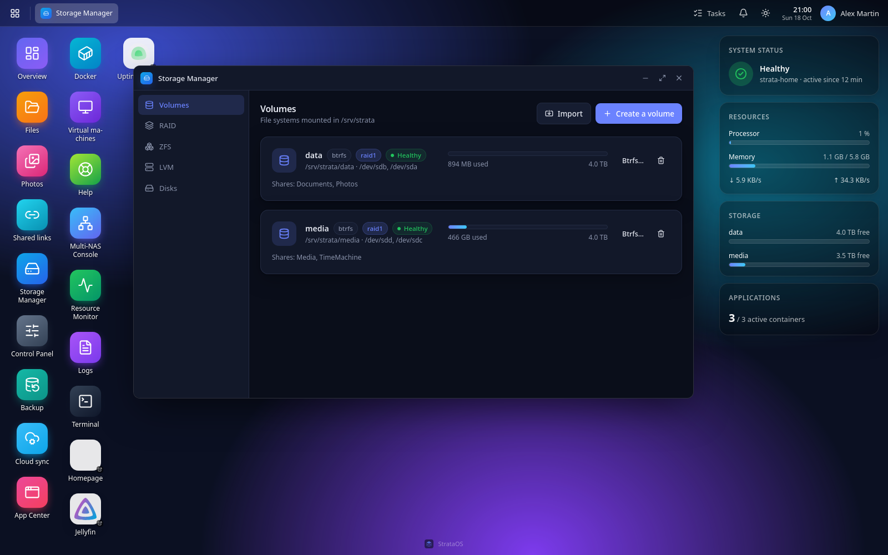
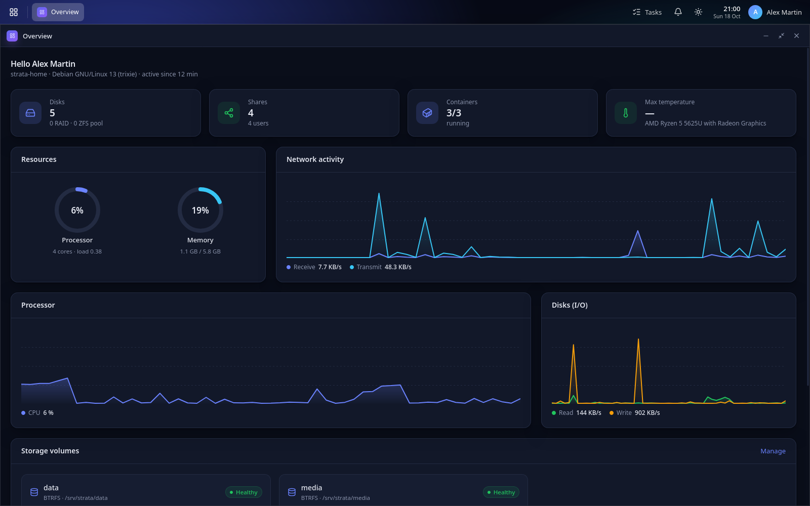
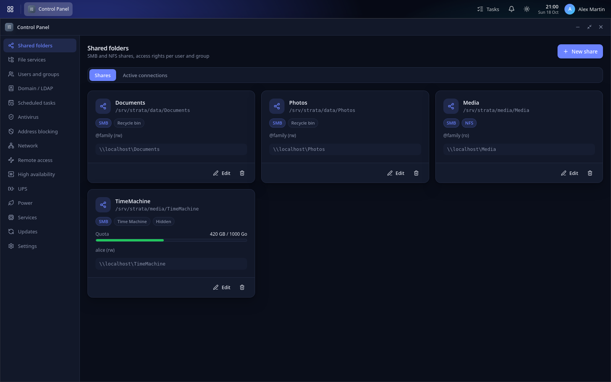
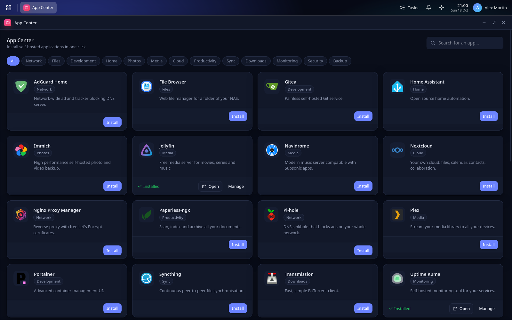
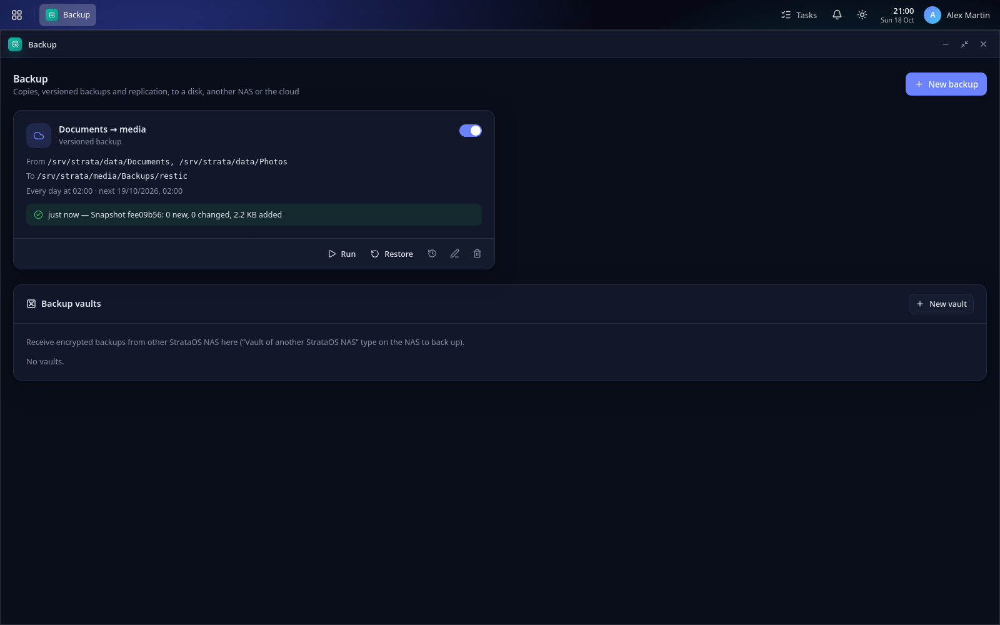
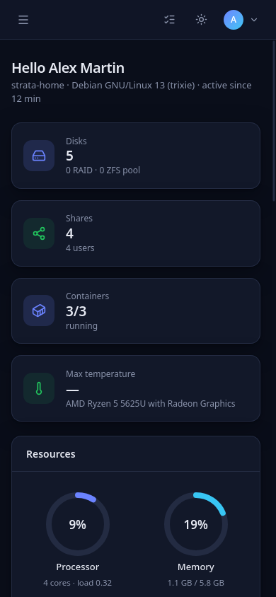
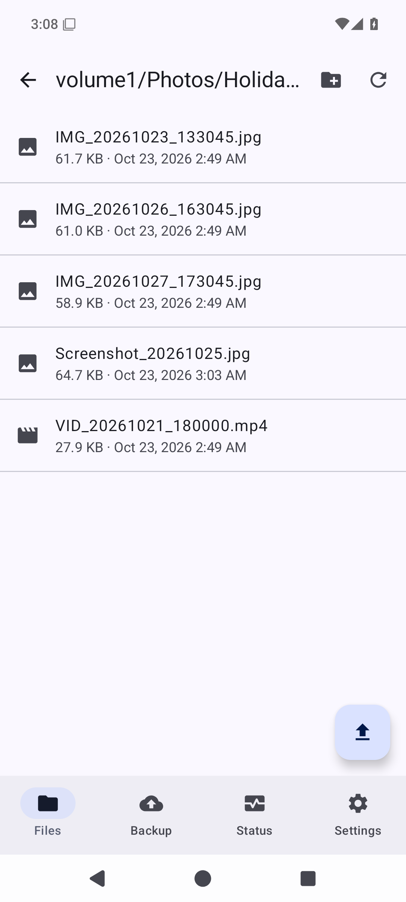
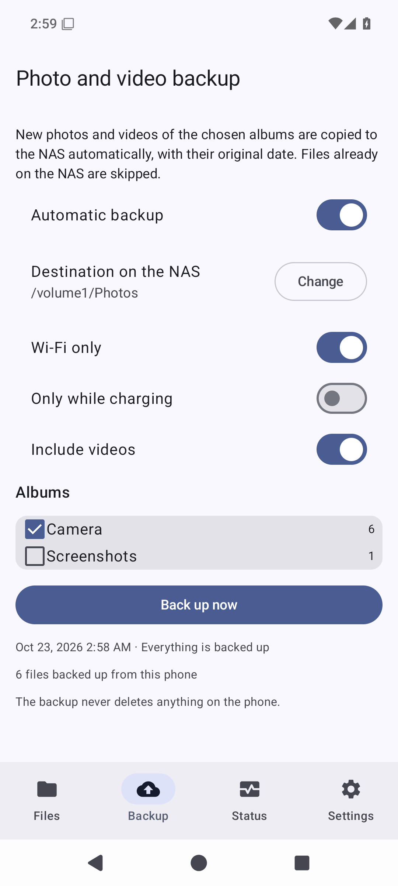
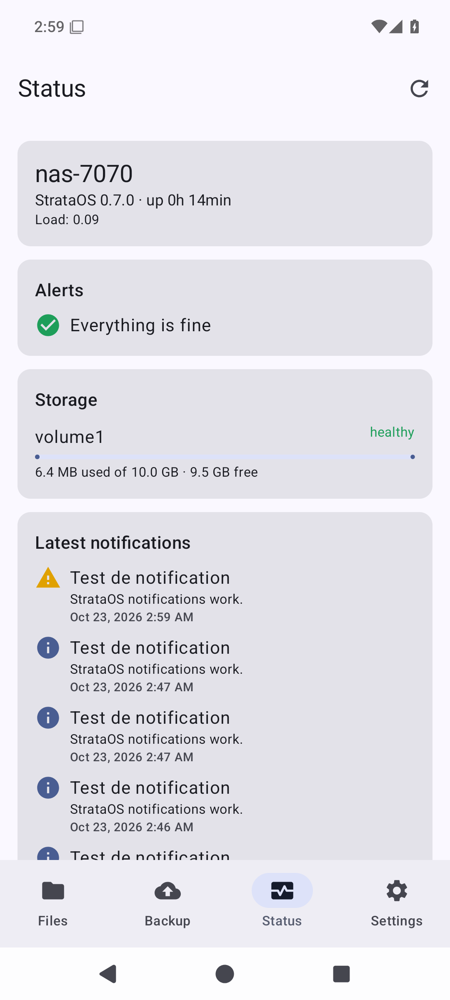
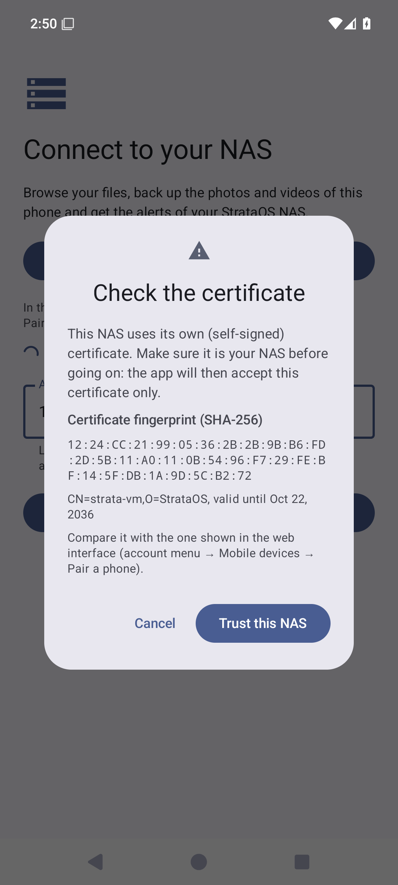

# StrataOS

**StrataOS turns a PC, a server or a Raspberry Pi into a full-featured NAS**, managed from a modern web interface. It's in the spirit of Synology DSM, TrueNAS or fnOS, built on Debian 13 (trixie) and its standard tools.

> *Strata* = layers: disks → RAID and pools → volumes → shared folders → apps.



- **Storage**: RAID (mdadm), Btrfs, ZFS and LVM, SSD cache, iSCSI targets, SMART monitoring, guided disk replacement, burn-in tests for new disks, a space analyzer and a duplicate finder.
- **Sharing**: SMB (Windows, macOS, Time Machine), NFS, WebDAV, FTP/SFTP, share links, a web file manager with a tabbed editor (and optional OnlyOffice for office documents), and a photo timeline.
- **Protection**: scheduled and locked snapshots, encrypted backups (restic, rsync, ZFS replication, backup vaults between NAS), backups pulled from other NAS (rsync, SSH, SMB), two-way sync, cloud sync, ransomware detection, antivirus, address blocking, and a configuration backup you can export and import.
- **Media and home**: DLNA server, multi-room music on AirPlay and Chromecast speakers, casting videos and photos to TVs, and video surveillance (built-in recorder, or Frigate with AI detection).
- **Apps and VMs**: Docker with an App Center of 50 ready-to-run apps (Jellyfin, Nextcloud, Immich, Home Assistant, Node-RED, Ollama…) plus your own; KVM virtual machines with cloud images, snapshots, clones and templates, imports from VMware and VirtualBox, USB and PCI passthrough.
- **Remote access**: WireGuard (devices per user, site-to-site, an outgoing tunnel for chosen apps), Tailscale, Cloudflare Tunnel, and app addresses with automatic HTTPS.
- **Everything else**: users and groups, sign-in with passkeys, Active Directory and LDAP, high availability between two or more NAS, UPS support, fan control and power scheduling, alerts (email, Telegram, ntfy, webhooks) with quiet hours, Prometheus metrics, and one-click updates with restore points.

The interface is available in English, French, Spanish, German, Italian, Portuguese (Brazil), Dutch and Simplified Chinese. On a computer it looks like a desktop with windows; on a phone it switches to a mobile layout.

## Screenshots

| | |
|---|---|
|  |  |
| **Overview** | **Shared folders** |
|  |  |
| **App Center** | **Backup** |

On a phone, the interface switches to a mobile layout:



### Android app

The StrataOS app (APK on the [Releases page](https://github.com/Nathplay15/StrataOS/releases), no Google services needed) browses and opens your files, shares files from any app to the NAS, backs up the photos and videos of the phone automatically (resumable uploads, original dates, nothing deleted on the phone) and shows the NAS health and alerts, with instant notifications through [UnifiedPush](https://unifiedpush.org) (ntfy…). Pair it by scanning the QR code in the web interface (account menu → **Mobile devices**).

   

## Requirements

|  | Minimum | Recommended |
|---|---|---|
| **Processor** | 64-bit x86-64 or ARMv8, 2 cores | 4 cores or more |
| **Memory** | 2 GB | 8 GB; 16 GB or more with ZFS, virtual machines or many apps |
| **System disk** | 16 GB | 64 GB SSD, separate from the data disks |
| **Data disks** | 1 | 2 or more, for RAID or mirroring |
| **Network** | Ethernet | Gigabit Ethernet or faster |

ZFS likes memory (about 1 GB per TB of storage is a comfortable rule of thumb), and each Docker app or virtual machine needs its own share of RAM. Virtual machines need a processor with hardware virtualization (Intel VT-x or AMD-V).

### Raspberry Pi

| Model | Support |
|---|---|
| **Raspberry Pi 5 / 500 / Compute Module 5** (4 GB or more recommended) | Supported: file sharing, backups, Docker apps. Boots from a microSD card, a USB SSD or an NVMe SSD (M.2 HAT). |
| **Raspberry Pi 4 / 400 / Compute Module 4** (4 GB or more recommended) | Supported: file sharing, backups, Docker apps. Use a USB SSD or a powered USB disk enclosure for your data. |
| **Raspberry Pi 3 B / 3 B+** | Supported for basic file sharing and backups. With 1 GB of RAM and USB 2.0, it isn't suited to Docker apps, ZFS or virtual machines. |

The Raspberry Pi image is Debian 13 with the Raspberry Pi kernel and boot firmware (from the Raspberry Pi OS archive, which supports every model). Docker is installed in one click from the App Center when you need it, and the iSCSI target isn't available (the Raspberry Pi kernel doesn't include it).

A Raspberry Pi installed from an image older than 0.6.1 runs Debian's kernel: Updates → **Switch to the Raspberry Pi kernel** moves it to the current image's kernels without reinstalling (needed for a Raspberry Pi 5, recommended for a Pi 3 or 4; see the [guide](docs/GUIDE.md#20-updates-and-rolling-back)).

Tested hardware, and how to check yours: [docs/HARDWARE.md](docs/HARDWARE.md) (also on the [website](https://nathplay15.github.io/StrataOS/docs/hardware.html)).

## Download

Get the latest version from the [Releases page](https://github.com/Nathplay15/StrataOS/releases) or from the [StrataOS website](https://nathplay15.github.io/StrataOS/):

| File | For |
|---|---|
| `strataos-<version>-amd64.iso` | PCs and servers (BIOS and UEFI) |
| `strataos-<version>-arm64.iso` | 64-bit ARM servers and boards that boot in UEFI mode |
| `strataos-<version>-raspberrypi.img.xz` | Raspberry Pi 5, 500, CM5, 4, 400, CM4 and 3 |
| `strataos_<version>_<arch>.deb` | An existing Debian 13 system |
| `strataos-<version>.apk` | The Android app (Android 8 and later) |
| `SHA256SUMS`, `SHA256SUMS.asc` | Checking your download (checksums, and their signature) |

### Checking your download

`SHA256SUMS` is signed with the StrataOS archive key, the one that signs the update repository. With the downloaded files, `SHA256SUMS` and `SHA256SUMS.asc` in the same folder:

```bash
curl -fsSLO https://nathplay15.github.io/StrataOS/strataos-archive.gpg   # or packaging/keys/strataos-archive.gpg from this repository
gpg --no-default-keyring --keyring ./strataos-archive.gpg --verify SHA256SUMS.asc SHA256SUMS
sha256sum -c --ignore-missing SHA256SUMS
```

gpg must report a **good signature from "StrataOS Archive"** with the fingerprint `6527 D6E8 6108 D178 3569 2EB2 0682 83FB D5C8 3F95` (the warning that the key isn't certified by a trusted signature is expected), then `sha256sum` must print **OK** for each file you downloaded.

Pre-releases (`0.8.0-beta.1`, `0.8.0-rc.1`…) are marked as such on the Releases page. Their files are named with the same version, e.g. `strataos-0.8.0-beta.1-amd64.iso`.

## Install

**With the ISO (PC, server, ARM board)**
1. Write the ISO to a USB stick with [balenaEtcher](https://etcher.balena.io/), Rufus (DD mode) or `dd`.
2. Boot the machine from the stick. **Install StrataOS** starts by itself after a few seconds.
3. The installation is automatic (English, US keyboard, UTC; the web interface has its own language setting). If the machine has several disks, you are asked which one gets the system. **That disk is erased**; the others are left alone.
4. When the machine restarts, its screen shows the address of the web interface.

**On a Raspberry Pi**
1. Write the `.img.xz` file to a microSD card or a USB SSD with Raspberry Pi Imager ("Use custom") or balenaEtcher.
2. Connect the Pi to your network with a cable and power it on. On first boot, the system grows to fill the card (2 to 3 minutes).

**On an existing Debian 13 system**

```bash
sudo apt install ./strataos_<version>_amd64.deb
```

Then open `http://<address-of-the-NAS>:7070` (HTTPS on port 7443). The setup wizard creates the administrator account and helps you prepare your disks, a first shared folder and the alerts.

The **[documentation](https://nathplay15.github.io/StrataOS/docs/)** (in English and French) walks you through everything, step by step: the user guide, a FAQ, tested hardware and the release notes. The user guide is also built into the interface (**Help** menu), and its source is here: [docs/GUIDE.md](docs/GUIDE.md) ([French](docs/GUIDE.fr.md)), with the [FAQ](docs/FAQ.md) next to it.

## Updates

StrataOS updates itself from its signed package repository, hosted on [GitHub Pages](https://nathplay15.github.io/StrataOS/). Go to **Updates → Update StrataOS** in the web interface. A restore point is taken before each update, so you can roll back with one restart if something goes wrong. Your settings and data are never touched by a rollback.

Updates can also install themselves: **Updates → Automatic updates** chooses, separately, what happens to StrataOS, to the Debian security updates and to the other system updates (nothing, a notification, or installation in a maintenance window), with a restore point before and an optional restart after. Tasks in progress (backups, scrubs…) postpone it.

**Update channel**: *Stable* by default. *Beta* also offers the pre-releases (from the `testing` suite of the repository) as soon as they are published. Going back to *Stable* keeps the beta installed until a newer stable version comes out; the interface can also go back to the latest stable version right away (with a restore point).

Systems installed with version 0.4 or earlier don't know this repository yet: install the 0.5 package once by hand (`sudo apt install ./strataos_0.5.0_<arch>.deb`), and later updates will arrive by themselves.

## Under the hood

StrataOS is one Go program with the React interface embedded, running as a systemd service. It doesn't reinvent anything: it drives the standard Debian tools (mdadm, LVM, Btrfs, ZFS, Samba, NFS, Docker, libvirt, rclone, restic…). The configuration stays readable in the usual places (`/etc/fstab`, `/etc/samba/smb.conf`, `/etc/exports.d/`, `/etc/mdadm/mdadm.conf`), so you're never locked in.

Want to build it, run the tests or contribute? See **[docs/DEVELOPMENT.md](docs/DEVELOPMENT.md)**.

## License

StrataOS is released under the [Apache License 2.0](LICENSE).
