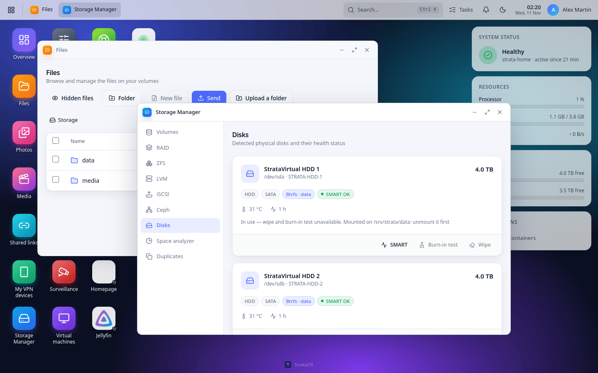
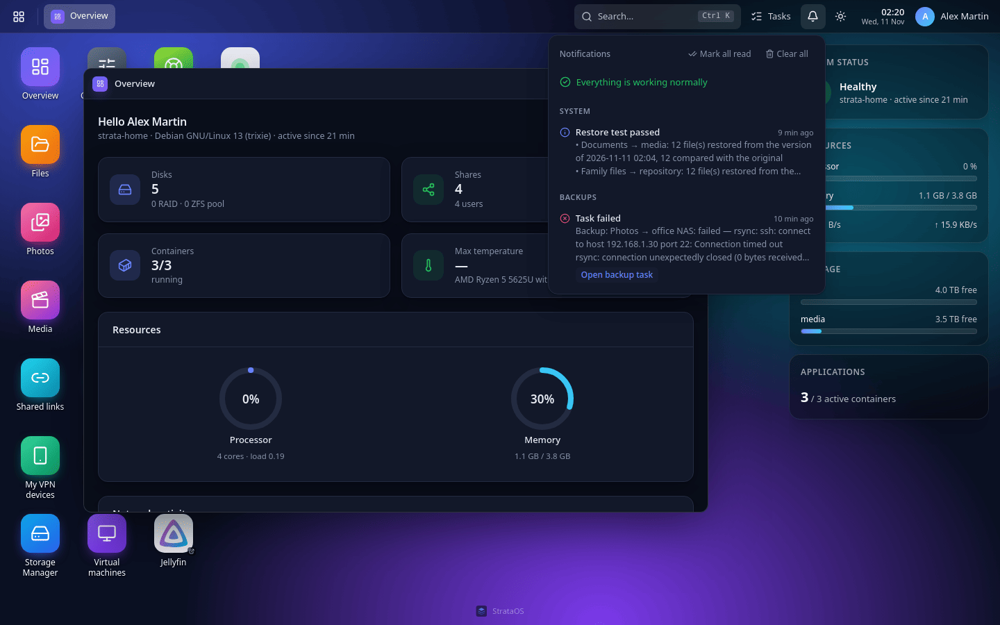
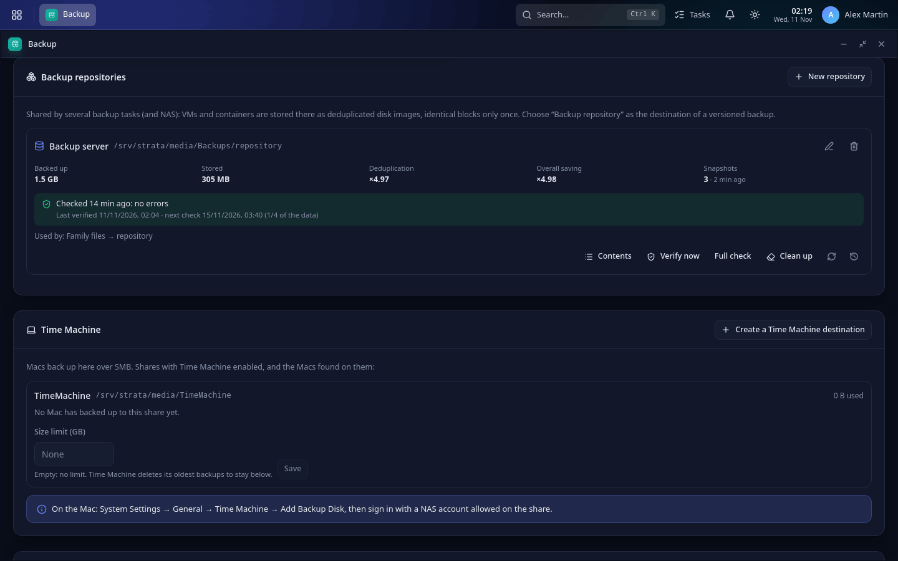
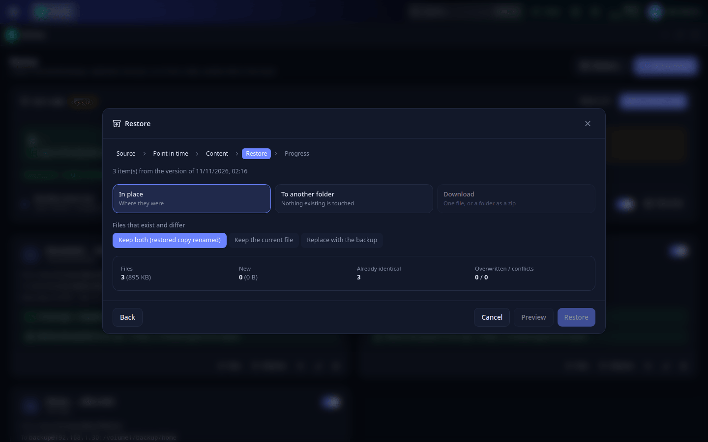
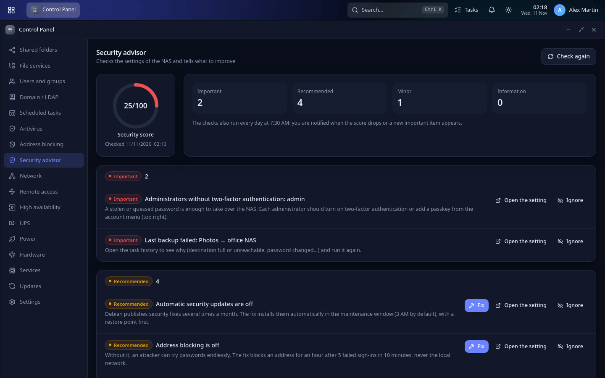
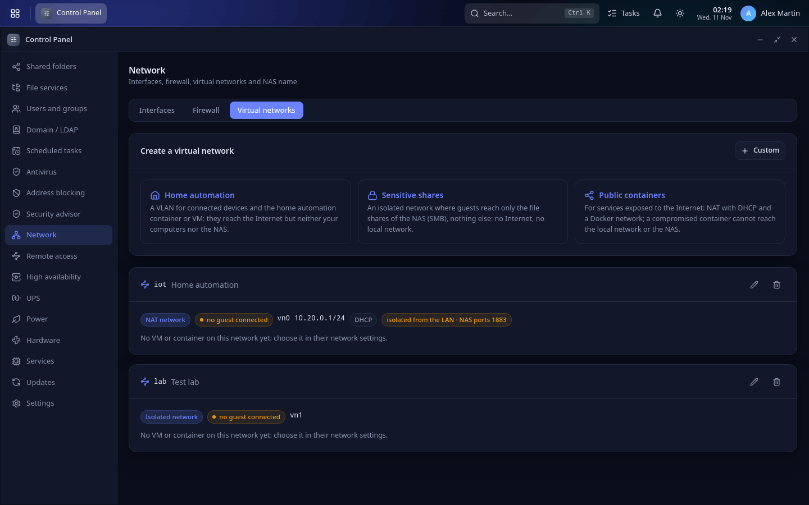
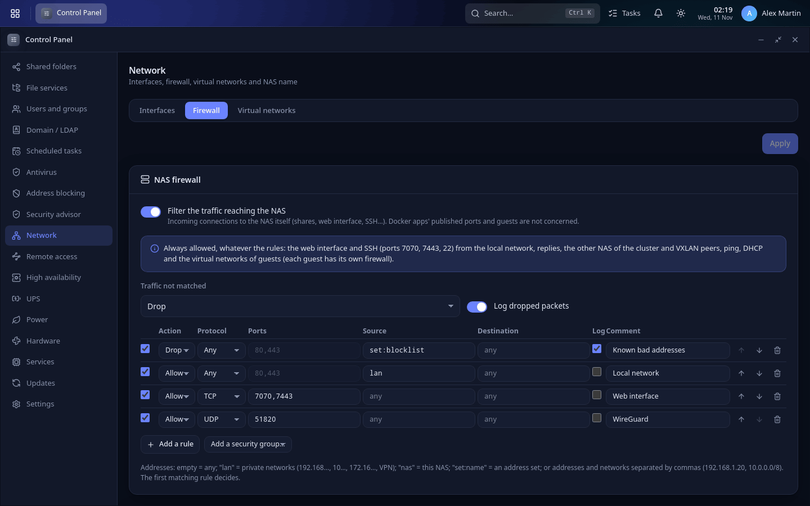
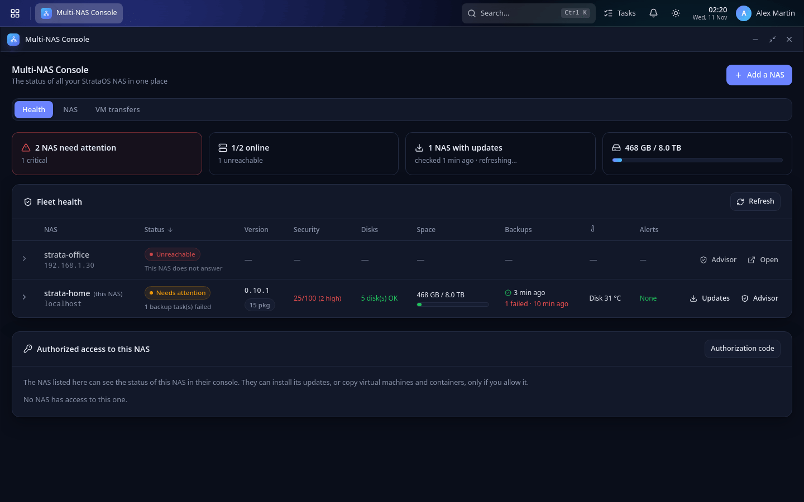
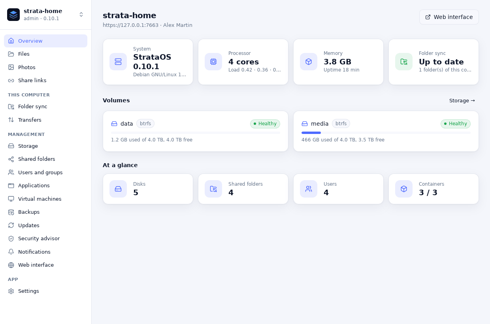

# StrataOS user guide

This guide walks you through installing StrataOS and using it day to day. Each page of the interface also explains the essentials; this guide gives you the logical order and the good habits.

## 1. Install StrataOS

**On a PC or server (amd64)**: download `strataos-<version>-amd64.iso` from the Releases page, write it to a USB stick (balenaEtcher, Rufus in DD mode, or `dd`), boot the machine from the stick and choose "Install StrataOS" in the boot menu. The installation is automatic and runs in English, with a US keyboard and the UTC time zone by default (the web interface has its own language setting). If the machine has several disks, the installer asks which one gets the system (the others are left untouched for your data). Allow 10 to 20 minutes.

**On a 64-bit ARM board (arm64)**: same steps with `strataos-<version>-arm64.iso`, on a machine that boots in UEFI mode.

**On a Raspberry Pi 5, 500, CM5, 4, 400, CM4 or 3 B / 3 B+**: write `strataos-<version>-raspberrypi.img.xz` to a microSD card or a USB SSD (Raspberry Pi Imager → "Use custom", or balenaEtcher), connect the Pi to your network with a cable and power it on. On first boot, the system partition grows to fill the card by itself; wait two to three minutes. The image is 64-bit. With 1 GB of RAM, a Pi 3 is fine for basic file sharing, but not for Docker apps, ZFS or virtual machines. On a Pi 5, the system can also live on an NVMe SSD (M.2 HAT): write the image to it like to a card. Docker isn't preinstalled on the Pi image, to keep it small: App Center → **Install Docker** adds it in one click.

**On an existing Debian 13 system**: `sudo apt install ./strataos_<version>_<arch>.deb`.

**Check your download** (recommended): each release comes with `SHA256SUMS` and its signature `SHA256SUMS.asc`, made with the StrataOS archive key (the one that signs the updates). The [website](https://nathplay15.github.io/StrataOS/#verify) gives the two commands to run and the key fingerprint to expect.

When it's done, the machine's screen shows the interface address and a QR code: `http://<address>:7070` (HTTPS: port 7443). Section 2 explains this screen.

## 2. First start

Open the address in a browser: the setup wizard asks for the language, the NAS name and the administrator account (this account can also use `sudo` over SSH). It then offers to prepare your storage, a first shared folder, alerts and recommended tasks (disk checks, snapshots).

Tip: turn on **notifications** right away (Settings → Notifications: email, Telegram, ntfy or webhook) so you hear about a failing disk. Notifications and reports are written in the language of the first administrator's interface; you can choose another one in the same place (Language of the messages sent by the NAS). Section 19 explains how to choose what each channel receives.

**The NAS's own screen**: a screen or TV plugged into the NAS shows its web addresses, a QR code to open the interface from a phone, its health (alerts) and how full its volumes are. With a keyboard, its menu (arrows or 1 to 5, then Enter) offers:

- **Network details**: the interfaces and their addresses.
- **Reset the network to DHCP**: every interface goes back to automatic addressing (static addresses, bonds, bridges and VLANs are removed). You then have 3 minutes to keep the new configuration; otherwise the previous one comes back by itself.
- **Administrator recovery code**: a one-time code, valid 15 minutes, to reset a forgotten administrator password (see section 21).
- **Restart or shut down**.
- **Login prompt (administrators)**: a normal login on the second console (Alt+F2); Alt+F1 brings the StrataOS screen back.

Settings → **Console screen** turns this screen off ("StrataOS screen on the NAS display"), or only the recovery codes ("Administrator recovery codes from the screen").

### Finding things and personalizing the desktop

**Desktop mode**: the address follows the window in front (for example `http://nas:7070/system/security` for the security advisor), so a reload, a bookmark or a link opens that window again at that page. Window sizes are remembered per app; a window made small on a small screen opens at its normal size on a much larger one. The desktop follows the light and dark themes (the sun or moon button of the taskbar). Large pages adapt their columns to the width of their window, not of the screen.

**Keyboard**: on the desktop, the arrow keys move between icons and Enter opens; **Alt+Shift+T** goes to the taskbar and **Alt+Shift+D** back to the icons; **Ctrl+`** (the key under Esc) switches windows like Alt+Tab: keep Ctrl down, press it again to go further (with Shift: backwards), release Ctrl to bring the chosen window to the front. Esc closes menus. **Shift+F10** (or the menu key) opens the desktop menu. Icons, windows, the taskbar and widgets are labelled for screen readers.

**Notification centre**: the bell (taskbar of the desktop, top bar of the classic interface) shows what is wrong now and, for administrators, the history of the notifications sent by the NAS, grouped by kind (updates, storage, backups, security…), with a direct action when there is one (Update, Open disk, Open backup task, Review…). The number on the bell counts the unread ones; opening the list marks them read; **Clear all** empties your list (the Android app keeps its own). Each administrator has their own read and cleared marks. The history holds the last 200 notifications.

**Search**: the search box at the top of the screen (or **Ctrl+K**, **⌘K** on a Mac, or **/** when you are not typing) finds applications, Control Panel pages, settings, shared folders and files; administrators also find virtual machines, containers and users. Results come grouped; the arrow keys move, Enter opens (a file opens in Files, a VM in its settings, a user in their account form), Esc closes. Names work in your language and in English. The file search looks through the shared folders you can read and shows the first matches only: for a full search, use the search of Files.

**Personalizing**: account menu → **Appearance** chooses the wallpaper of the desktop mode (a few built-in ones, or your own image: any picture is reduced to 3840 × 2160 and kept as a JPEG of 5 MB at most, on the NAS, for your account only) and the **accent colour** of the whole interface (buttons, links, selections), adjusted a little in the light and dark themes so text stays readable. In the desktop mode, right-click the desktop → **Customize widgets** (or the button that appears under the widgets) to choose the widgets on the right of the screen and their order: system status, resources, network throughput, storage, notifications, and for administrators applications, Docker containers, virtual machines and containers, UPS, last backups and disk temperatures. The widgets show on large screens only, and only refresh while they are visible. The desktop icons sit on a grid: drag them where you want, or right-click the desktop → **Rearrange icons** to put them back in order. These choices are saved on the NAS and follow you from one browser to another.

## 3. Storage

Storage is built in layers: **disks → RAID array or pool → volume → shared folders**.

1. **Disks**: check the SMART status of each disk. A disk that is "degrading" should be replaced soon.
2. **Redundancy**: choose how to protect yourself against a disk failure:
   - an **mdadm RAID array** (RAID 1 with 2 disks, RAID 5 with 3 or more, RAID 6 with 4 or more), with an ext4 or XFS volume on top;
   - or a **Btrfs** volume across several disks (RAID 1 or RAID 10 profile);
   - or a **ZFS pool** (Storage → ZFS, one-click install), as a mirror or RAIDZ.
3. **Volume**: it is mounted at `/srv/strata/<name>`. A volume on a single device can get an **SSD cache** when you create it.

RAID is not a backup: it protects you from a disk failure, not from an accidental deletion, ransomware or a fire.

**SMART history**: StrataOS records the SMART values of each disk about once an hour while it is awake (sleeping disks are never woken up for this): reallocated, pending and unreadable sectors, cable (CRC) errors, temperature, power-on hours and, for SSDs, the wear, the spare cells and the data written. Storage → Disks → SMART → **History** shows them as graphs over 7 days, 30 days, a year or everything (hourly points for a week, then one a day, kept two years). When a counter grows, for example reallocated sectors going from 24 to 30, you get one notification "getting worse" for that change, not one per check: a disk with a few old reallocated sectors that stay stable is not a worry, a count that keeps rising is.

**SSD wear**: SSD and NVMe cards in Disks show the wear (percentage of the rated endurance used), the data written and, after a few days of history, the time left at the current write rate. SMART does not give the rated endurance (TBW): StrataOS estimates it from the data written and the percentage used, so treat it as an order of magnitude. When the SSD is an **LVM cache** (Storage → LVM, under the cached volume) or a ZFS read cache (L2ARC) or log device (SLOG), you also see the share of reads it serves and advice, for example that a consumer SSD in write-back mode wears faster. You are notified when the wear passes 80 % and 90 %.

**Test new disks first**: before putting data on a new disk, run a **Burn-in test** (Storage → Disks, on a free disk). It chains a SMART short test, a surface test of every block and a SMART extended test, then compares the sector counters before and after. Choose "Read-only (non-destructive)", or "Write test (erases the disk)" for the most thorough check. Both modes need a free disk: a disk in use (RAID member, LVM, imported ZFS pool, mounted) cannot be tested or wiped, and its card says why. A full test of a large disk takes a day or more; you are notified of the result.

### Replacing a disk

When a disk shows signs of wear (reallocated sectors, errors) or fails, click **Replace** on its card in Storage → Disks. The same wizard opens from the SMART warning, from the security advisor, from the alert of a degraded array on the dashboard, and from the RAID and ZFS pages ("Replace the missing disk").

1. **Situation**: which RAID array, ZFS pool or LVM volume group uses the disk, what it holds, how many more disks can fail, the SMART state of the other disks and the date of the last successful backup.
2. **Method**:
   - **Add the new disk first** (recommended, when the old disk still works and you have a free bay or port): the data of the old disk is copied onto the new one while the old one stays in service, so the data keeps its protection (`mdadm --replace`, `zpool replace`, or `pvmove` for an LVM volume group). The old disk is then taken out.
   - **The failed disk is already removed**: the missing data is rebuilt onto the new disk from the other disks.
3. **New disk**: StrataOS lists the disks that are large enough and not in use, offers a 2-minute SMART self-test first (run a burn-in test beforehand for a thorough check), and erases the chosen disk only after you type its name.

The replacement then runs in the background, with its progress and the time left ("Rebuilding 42 %", the same words on the RAID and ZFS pages). You can close the window or reload the page: a banner on the storage pages shows it, and it even goes on after a restart of StrataOS. At the end you are notified, and the wizard tells which disk to pull: its **serial number** (printed on its label) and model. If `ledctl` (package `ledmon`) is installed and your enclosure supports it, the LED of its bay blinks.

StrataOS refuses, and says why, when the replacement would put data at risk: no redundancy (RAID 0 or JBOD), too many disks missing, another disk of the array also failing (back up and replace that one first), an array that is already degraded (rebuild the missing disk first), a rebuild already running, a new disk that is too small or in use. Btrfs volumes, Ceph disks and the system disk are not handled by the wizard: it tells where to go instead. You receive one notification when a rebuild starts and one when it ends, not one per step.

**iSCSI** (Storage → iSCSI) offers network disks to VMware, Proxmox, Hyper-V, Windows or Linux servers. "Create a target", add one or more **LUNs** (an image file on a volume, an LVM logical volume or a ZFS volume), then list the **allowed initiators**: nobody can connect while the list is empty. Turn on **CHAP authentication** if the storage network is not isolated, and never let two computers write to the same LUN unless they use a cluster file system.

## 4. Free up space

- **Space analyzer** (Storage → Space analyzer): shows what takes up space in a volume or a shared folder, by folder and by file type, with the largest files and the large files not modified for a year. The analysis runs in the background; the result is kept until the next scan.
- **Duplicates** (Storage → Duplicates): finds identical files (same content, not just the same name). Check the copies to remove, or use "Select all but the oldest". At least one copy of each group is always kept, and files go to the recycle bin of their shared folder when it has one.

## 5. Users and shared folders

1. **Users**: create one account per person and put them in **groups** (for example "family" or "accounting"). Turn on two-factor authentication for administrators.
2. **Shared folders**: create one shared folder per purpose (Documents, Photos, Media…) on the volume of your choice, then set permissions per user or per group: read and write, read only, or no access. By default, the account that creates the folder can read and write and all other users can read.
3. Useful options: **network recycle bin** (deleted files are kept in `.recycle`), a **quota** for the share (it can switch to read-only once full if you want), and **encryption** (see section 12).

## 6. Access your files

- **Windows**: in File Explorer, type `\\<address>\<share>` and sign in with your StrataOS account.
- **macOS**: Finder → Go → Connect to Server → `smb://<address>/<share>`. For Time Machine backups, see section 9.
- **Linux**: `smb://` in your file manager, or NFS if the share allows it.
- **Browser**: the **Files** app lets you upload (files or a whole folder), download (folders as ZIP), rename and create a "New file". Files open in tabs, so you can keep several open side by side: text and code in an editor (syntax highlighting, search and replace, Ctrl+S; up to 5 MB, read-only in read-only shares), Markdown with a live preview, images, PDF, audio and video. If someone else changed a file while you edited it, StrataOS asks whether to reload it or overwrite it.
- **Viewing files**: double-click a file to open it in a tab. PDFs open in the built-in viewer (search, zoom, print); Word and Excel files (and CSV) preview directly; any video or audio file plays, even formats the browser doesn't know (the NAS converts them on the fly); HEIC, TIFF and RAW photos display; zip, tar, 7z and RAR archives can be browsed and extracted. PowerPoint and other documents need the optional **Document previews** component (Settings → Components, about 400 MB). "Open with" lets you choose between the viewer, the text editor, OnlyOffice and a download; the details panel shows the type, owner and a SHA-256 on demand.
- **Office documents**: install **OnlyOffice Docs** from the App Center (about 3 GB), then turn on "Open office documents with OnlyOffice" in Settings (Office documents card). Word, Excel and PowerPoint (and OpenDocument) files then open in OnlyOffice; several people can edit the same document together, and those who can only read the share get a read-only view. The container reaches StrataOS at `http://host.docker.internal:7070` (the HTTP port must stay on); another document server can be set in the same place. If you use StrataOS over HTTPS, give the document server an HTTPS address too (browsers block an HTTP editor in an HTTPS page).
- **Android phones**: the StrataOS app browses your files and backs up your photos (see section 22).
- **Computers (Windows, macOS, Linux)**: the StrataOS desktop app keeps folders of the computer and of the NAS identical, in both directions, and browses and manages the NAS (see section 23).
- **Other devices**: turn on WebDAV, SFTP or FTP in File services.
- **S3** (File services → S3): exposes shared folders as **S3 buckets** for backup software (Restic, Kopia, Duplicati, Veeam…), rclone, the `aws` command or applications. Install it from the card (a single program, versitygw, downloaded from its official release and checked against a pinned checksum), turn it on, choose the port (7380 by default; HTTPS with the NAS certificate) and the shared folders to expose; each one gets a bucket name (lowercase letters, digits, dots and hyphens). Each user then creates **access keys** from the account menu → **S3 access keys** (the secret is shown once; give each application its own key and revoke it there). A key has the rights of its user on the shared folder: read and write, read only, or nothing, as over SMB, and read-only while the folder is over its quota or frozen; revoking a key or changing a permission takes effect at once. The objects are the folder's ordinary files: what you upload over S3 appears in Files and over SMB (owned by the user), and the other way round. Use the path style (`https://nas:7380/photos/file.jpg`) — the virtual-host style (`https://photos.s3.nas.example.com:7380`) needs a domain in the card and a wildcard DNS entry. Clients address a bucket by its name: listing all buckets shows none. "Recent requests" shows who did what (from the access log). Not supported: versioning, object lock, encrypted shared folders. Uploads in progress are kept in a hidden `.sgwtmp` folder of the shared folder. **How it differs from the MinIO app** of the App Center: MinIO is a separate object store with its own storage folder, users, buckets and console; the built-in service stores nothing of its own and follows the NAS accounts and shared folder permissions. With a self-signed certificate, tell the client to accept it (rclone `--no-check-certificate`, aws `--no-verify-ssl`).

To **share with someone who has no account**, use "Share a link" on a file or folder (password, expiry date, download limit, or a drop box to receive files).

- **File requests**: on a folder, "Share a link" → **Request files** makes a link through which anyone can send you files, without seeing what the folder holds and without ever replacing a file (a file with the same name is stored as "name (2)"). You can show a title and a message, ask for the sender's name and email (optional or required) and put each named sender's files in their own sub-folder, limit the size of each file and of everything received, and be notified when files arrive (administrators through the NAS notifications; other users by email, when the NAS can send mail and their account has an address). The NAS always keeps 1 GB free and respects the owner's quota.
- **Shared links** lists your links (administrators see everyone's) with their state (active, expired, download limit reached, size limit reached) and lets you **edit** them (expiry date, password — a new one signs out the visitors who had unlocked the link —, limits, file request options) and see their **statistics**: views (counted once per visitor address every 30 minutes), downloads, files and data received, last access, and the last 100 files received with their sender.
- A download is counted when it starts; previews of images do not count, nor do resumed parts of a download. Once the limit is reached, an interrupted download cannot be resumed.
- Visitors are limited per address (pages and downloads, uploads) to slow down robots; links keep working with the rights of their owner, checked at each request.

## 7. Photos

An administrator chooses the photo folders (Photos → Folders). The timeline shows photos and videos by month; each person only sees the shared folders they have access to. Select photos to create **albums**, which you can share with a link.

## 8. Media: TVs and speakers

The **Media** page brings your videos, music and photos to the screens and speakers of your home.

- **DLNA server**: TVs, game consoles and media players of the local network find the NAS by themselves and browse the "Published folders". DLNA has no password: every device at home can see these folders, even if the shared folder is private, so only publish what everyone may watch.
- **Music & speakers**: install **OwnTone** from the App Center, choose your music folders, then play your library on **AirPlay** and **Chromecast** speakers. Turn on several speakers to play in every room at once, in sync. By default only administrators control the music; you can let every user do it.
- **Cast**: in Files or Photos, the **Cast** button plays a video, a song or a picture on one or several TVs (Chromecast or DLNA). The TV plays the original file, so it must support its format; for conversion on the fly, use Jellyfin from the App Center. The Cast tab shows what is playing and lets you pause or stop it.

## 9. Back up

Always keep at least one copy of your data somewhere other than the NAS (the 3-2-1 rule: 3 copies, on 2 different media, 1 off site). In **Backup**, "Create a backup" offers:

- **File copy**: an rsync mirror to a USB disk, a volume or an SSH server.
- **Back up another NAS**: this NAS fetches folders from another NAS or server, by **rsync over SSH**, an **rsync daemon** (offered by Synology, QNAP and TrueNAS) or an **SMB share** (Windows, any NAS). With "Keep versions (snapshots)", a read-only snapshot of the destination is taken after each run (Btrfs or ZFS), so earlier states stay recoverable even if files were deleted or encrypted on the other NAS.
- **Versioned backup** (restic, encrypted and deduplicated) to a folder, an SFTP server, S3 storage or a **vault on another StrataOS**: on the other NAS, create a vault (Backup → Backup vaults, ideally append-only) and show its code; on this NAS, choose the destination "Vault of another StrataOS NAS" and enter the code. A backup task can also include **virtual machines** (see section 15).
- **ZFS replication**: send a dataset to another pool, or **fetch** one from a remote ZFS host (pull). In pull mode, the source has no access to this NAS, so even if it is compromised it cannot delete its backups.
- **Two-way sync**: keeps a folder identical on two NAS, with changes on both sides. Be careful: **deletions propagate both ways**, so a file deleted on one NAS is deleted on the other at the next run. A snapshot of the local folder is taken before each run (Btrfs or ZFS), so a mistake can be undone. Two-way sync is not a backup on its own.
- **Cloud sync** (Google Drive, OneDrive, Dropbox, S3…), on its own page (below).

**Cloud sync** (its own app, rclone installed in one click) keeps a NAS folder and a folder of a cloud service in step: Google Drive, OneDrive, Dropbox, S3, Backblaze B2, WebDAV, SFTP and more. "Create a sync", connect the account (for services that sign in with a browser, the page explains how to get the token from a computer), then choose the NAS folder, the remote folder and the direction: **upload to the cloud** (the NAS is the reference), **download from the cloud** (with "Exact mirror", deletions are copied too) or **Bidirectional (beta)**, where changes and deletions on either side are propagated. Each sync runs on a schedule or on demand, with exclusions (`*.tmp`, `Cache/**`…), a bandwidth limit and a history. A sync is not a backup: for an encrypted, versioned copy in the cloud, use a versioned backup to S3 or B2.

**Backup repositories** (Backup → Backup repositories) are shared destinations for versioned backups, like a backup server: several tasks, and several NAS, write into one encrypted restic repository, and identical data is stored only once, whatever task, VM or NAS it comes from.

- **Create one**: a name, a location (local folder or USB disk, SFTP server, S3, restic REST server or a vault on another StrataOS) and a password. To share it with another NAS of your fleet, add it there with the same location and password; for a vault, create it as "One repository for all the paired NAS". Each NAS then sees the backups of the others in the repository's contents and can restore their VMs.
- **Use it**: in a versioned backup, choose the destination "Backup repository". Its **virtual machines** and **containers** are then stored as images cut into blocks: each VM disk is read as a whole while the VM is held still (temporary snapshot, pause or shutdown, as chosen), each container as an archive. Blocks already in the repository (another VM made from the same template, an earlier run, another NAS) are not stored again, so the second backup of a VM usually costs little. Folders of the same task are backed up as usual.
- **Retention**: keep the latest N, and N hourly, daily, weekly, monthly and yearly versions. Each VM, container and the folders keep their own versions; the data nothing uses any more is removed by the repository's daily cleanup ("Clean up" runs it now; an append-only vault is never cleaned).
- **Sizes**: the card shows what the backups hold (backed up), what the repository takes (stored), the **deduplication** factor and the overall saving (deduplication and compression). "Contents" lists every backup with its size and the new data it added.
- **Restore a VM or a container**: in Contents, "Restore" recreates it under a new name, or replaces the one of that name (it must be shut down or stopped; it is deleted only once the backup has been read back completely). The VM app's backup list shows these backups too.
- **Single files from a VM disk**: in Restore…, the VMs of these tasks appear as "VM disks". Pick a version and a disk, then "Open the disk": it is read back onto a volume and its partitions are mounted read-only (ext4, XFS, Btrfs, NTFS, FAT, and the logical volumes of LVM inside the guest). Browse it like any backup, then download files or restore them **to a folder** (not in place: they have no place on the NAS to go back to). Close the disk when done; it also closes after 30 idle minutes, and at most two disks are open at once. The backup itself is never modified.
- **Integrity checks**: each repository is checked on a schedule (weekly by default) without restoring anything: restic reads the data back and checks every block. Each check reads one part of the data in turn, so that all of it is read over a number of checks you choose (4 by default; 1 = everything each time). "Verify now" runs the next part, "Full check" reads all of it. A failure is notified, logged, shown on the card with the damaged files and the backups (snapshots) affected, and raised in the security advisor, which also warns about a repository never checked or not checked for 35 days.
- These backups count in the 3-2-1 card like any other: off site when the repository is remote or cloud, or a USB disk marked "Kept off-site".

Limits: the whole disk of a VM is read at each backup (no changed-block tracking yet): only the new blocks are stored, but the time grows with the disk size. VM disks on Ceph cannot be backed up as images. Opening a disk for single files needs free space on a volume for the data it holds (it is written there sparsely) and takes as long as reading it; encrypted (LUKS) partitions and volume groups named like one of this NAS are not opened. Containers are restored whole (single files: restore the container under a new name).

**Time Machine**: the Backup page also lists the Time Machine destinations and the Macs that back up to them. "Create a Time Machine destination" creates the folder and the share in one go, with an optional size limit; on the Mac, go to System Settings → General → Time Machine → Add Backup Disk.

Keep your restic backup password somewhere safe: without it, nothing can be restored.

**Choosing a folder.** Wherever StrataOS asks for a folder of the NAS (the destination of a backup, the NAS side of a cloud sync or a two-way sync, a backup repository, a backup vault, a Time Machine destination, the folder a restore goes to), you can type the path, pick a volume or a shared folder from the list, or click **Browse…** to go through the folders. In the browser, **New folder** creates a folder where you are, and **New shared folder** creates a shared folder (name and volume) with the usual defaults: shared over SMB with a recycle bin, you can write to it and the other users can read it. It is chosen straight away, without leaving the form. To change its permissions or make an encrypted folder, use Shared folders.

**Servers with a self-signed certificate.** A WebDAV server (another NAS, a Nextcloud at home), an S3 endpoint (MinIO…) or a restic REST server reached over HTTPS often has a certificate no public authority signed. StrataOS then refuses it, and the task fails with a message saying so. In the task (cloud sync, versioned backup, backup repository), the **Server certificate** block offers **Check the certificate**: the NAS connects to the server and shows its certificate (subject, issuer, validity dates and SHA-256 fingerprint). Compare the fingerprint with the one the server shows, then click **Trust this certificate**: it is saved with this task and used for this connection only, nowhere else. If the server later presents another certificate (renewed, reinstalled, or someone in between), the task fails with "the certificate of … changed" and a **Review the certificate** button: check it again and trust the new one if the change is expected. As a last resort, **Ignore certificate errors** accepts any certificate (off by default): the connection stays encrypted, but the NAS no longer checks who it talks to. The same block is in Settings → Notifications (webhook, self-hosted ntfy, mail server), for sign-in providers (OpenID Connect: trust only, errors can never be ignored there) and for LDAP. Limits: rclone and restic check the server name even for a trusted certificate, so the address must use a name written in the certificate (the check warns when it does not; old certificates with only a "common name" are refused); for LDAP, a trusted server certificate signed by a private authority may need the authority's own certificate pasted instead.

**Stopping a task.** Running tasks have a **Stop** button in the Tasks menu (top bar, or the taskbar in desktop mode), on backup, cloud sync and backup repository cards while they run, and in the restore window. StrataOS asks for confirmation, then ends the programs the task started (rclone, restic, rsync, ssh…), first politely, then forcibly after 10 seconds. A stopped task shows "Stopped by <name>" instead of an error, and the history says "stopped". What was already done is kept: a stopped backup leaves its earlier versions intact, the next run starts again, and the backup repository is unlocked automatically. Some tasks cannot be stopped, and their button is greyed out with the reason: system and component updates (interrupting the package manager could break the system), storage operations (RAID or volume creation, ZFS, Btrfs), the rebuild during a disk replacement (it goes on in the background whatever StrataOS does), the creation of VMs, containers and apps, and the final step of an in-place restore.

**The 3-2-1 card** at the top of Backup shows where the NAS stands: how many copies of the data exist (the original counts), on how many different media (the NAS, a USB disk, another NAS or server, the cloud) and how many are off site. Only tasks that succeeded recently count; snapshots and RAID do not count, since they live on the same disks. "Add an off-site copy" opens the backup editor already filled in for the cloud (encrypted versioned backup to S3, B2, Wasabi, MinIO…), for another StrataOS NAS (vault; the NAS of your fleet are listed with their address) or for a USB disk. A USB disk counts as off site only if you tick "Kept off-site" in its task, that is, if you really take it away between backups. The security advisor shows the same assessment.

**Restoring** ("Restore…" at the top of Backup, the "Restore" button of a task, or a right click on a file or folder in Files → "Previous versions / Restore…") is a guided process:

1. choose what to restore (files or folders, a whole shared folder, or the whole NAS) and the source: the snapshots of a volume, a versioned backup, a file copy to a local folder, or a cloud upload;
2. pick the point in time on the timeline;
3. browse its content and tick what to bring back;
4. choose **in place**, **to another folder** (nothing existing is touched) or **download** (one file, or a folder as a zip), and what to do with files that exist and differ: keep both (the restored copy gets "(restored <date>)" in its name), keep the current file, or replace it. **Preview** lists how many files come back, which ones would be overwritten and the **conflicts**: files changed after that backup. On Btrfs and ZFS, a snapshot is taken before overwriting, so the restore itself can be undone;
5. the restore runs as a job, with its progress and log.

For **the whole NAS**: on a new or reinstalled NAS, first import the configuration (section 10), which brings back the volumes, shared folders, accounts and backup tasks; then restore the data of a backup here. When the backup holds a configuration export, the wizard offers to import it at the end.

**Restore tests**: once a month (the 1st at 5:20 AM, or the next morning if the NAS was off), a sample of files is restored from the newest version of every backup to a temporary folder, read back and compared (SHA-256) with the original when the original has not changed since. The result shows on each task, a notification is sent, and a failure appears in the security advisor. "Test now" runs them at once; you can turn them off. Restic also checks its own data during the test.

Limits: restores read versioned backups (any destination, vaults included), file copies to a folder of this NAS, cloud uploads and snapshots. File copies to an SSH server, ZFS replications and two-way syncs are not browsed here (restore them with the usual tools). Folders of a cloud copy cannot be downloaded as a zip: restore them to a folder. A cloud copy and a file copy have a single point in time, their last run. Restore tests take at most 12 files and 128 MB per backup; files changed since the backup are only checked for their size.

## 10. Configuration backup

Your settings deserve a backup too. In Settings → **Configuration backup**:

- **Export** downloads a JSON file with the settings, accounts, shared folders, tasks, apps, network and security settings (not your files). With "Include the secrets", passwords, tokens and keys are added, encrypted with a passphrase you choose: without it, they cannot be recovered.
- **Import** restores such a file, for example on new hardware or after a reinstall. A **preview** shows what will be created or changed, section by section; you choose what to bring back. Nothing that exists only on this NAS is removed, and disks and volumes are never touched: map each volume of the file to a volume of this NAS.
- **Daily automatic backup**: a copy of the configuration every day in a folder of your choice, ideally a shared folder that is itself backed up.

## 11. Snapshots and previous versions

On Btrfs and ZFS, schedule **snapshots** (Scheduled tasks → Recommended plan, or a new Snapshot task). The target can be a volume, a Btrfs sub-volume, a ZFS dataset, an LVM **thin** volume, or a **shared folder**: StrataOS picks what holds it (a folder that is not a sub-volume or dataset of its own is snapshotted with its whole volume). Schedule them hourly, daily or weekly.

**Retention**: keep the last N snapshots and/or those younger than N days, or use the calendar: the newest snapshot of each of the last N **hours**, **days**, **weeks** and **months** (for example 24 hourly, 7 daily, 4 weekly, 6 monthly). With a calendar rule, each rule keeps its snapshots; without one, a snapshot must satisfy both the count and the age, as before. Only snapshots made by the task are deleted, the newest one is always kept, and a **locked** snapshot cannot be deleted for the period you choose, not even by an administrator or by ransomware. The task's "Snapshots" button lists them and shows which ones the next run will delete, and "Browse and restore…" opens the restore wizard on them.

To recover a file: in **Files**, right click the file → "Previous versions" (or "Previous versions / Restore…" for an administrator, which also offers backups); on Windows, open the file's or the share's Properties → Previous Versions. A shared folder that is a Btrfs sub-volume with its own snapshot task shows those snapshots in Windows; the others show the snapshots of the whole volume.

Limits: LVM thin snapshots cannot be locked, and they are mounted read-only only while being browsed; they do not appear in Windows Previous Versions. StrataOS does not create LVM thin volumes itself.

## 12. Protect the NAS

- **Ransomware protection** (Antivirus): watches for mass renames over SMB, WebDAV, SFTP, FTP and NFS and blocks the account responsible. Also turn on **trap files** (`!0000 - DO NOT MODIFY (StrataOS).docx` and `zzzz - DO NOT MODIFY (StrataOS).xlsx`, which sort first and last in each shared folder): if they are touched, the shared folder becomes read-only. After an alert: check the computer involved, restore from snapshots, then unblock the account and restore the shared folder.
- **ClamAV antivirus**: scheduled scans of your shared folders.
- **Address blocking**: blocks addresses with too many failed sign-ins, and can limit access from the internet to certain countries.
- **Encrypted folders**: protect your data if the NAS or its disks are stolen. After each restart, an administrator must unlock them (Shared folders → Unlock). Keep the recovery key somewhere safe.
- **Two-factor authentication for administrators**: an administrator without an authenticator app or passkey is invited to set one up right after signing in (QR code to scan, or a passkey); "Remind me in 7 days" postpones it. In Settings → **Two-factor authentication for administrators**, "Require two-factor for administrators" (you need a second factor yourself first) gives the others a grace period (none, 3, 7, 14 or 30 days, counted from the moment they are first asked); after it, such an administrator can still sign in with the password but can only set up a second factor, nothing else, so nobody is ever locked out by this setting. While it is required, an administrator cannot remove their last second factor, and an administrator protected only by passkeys must sign in with a passkey (the password alone is refused). Lost phone or passkey: another administrator removes them in Users, or, alone, you generate a recovery code on the NAS screen and use "Forgot password?" on the sign-in page with "Also remove two-factor authentication and passkeys" (section 21). For that reason the setting refuses to turn on with a single administrator while console recovery codes are disabled, and the reverse. Sessions of the phone and desktop apps (paired devices) are not concerned.
- **Passkeys**: sign in with your fingerprint, your face, your device PIN (Windows Hello, Touch ID, Android) or a security key, instead of a password and a two-factor code. Add one from your account menu → Passkeys → "Add a passkey", then use "Sign in with a passkey" on the sign-in page. Passkeys only work when you open the NAS **by its name over HTTPS** with a valid certificate (for example `https://strataos.local:7443` or your own domain), not by its IP address; a passkey only works on the name it was created on.
- **Security keys** (YubiKey, SoloKey, Google Titan… FIDO2 or older U2F keys): a second factor plugged in or tapped after the password, as an alternative or a complement to the authenticator app. Account menu → **Security keys and sign-in** → "Add a security key" (your password is asked first). Register two keys and keep one in a safe place. When you add the first key, StrataOS gives you **recovery codes** (shown once); each one replaces the key for one sign-in, and "New recovery codes" makes a fresh set. At sign-in, after the password, click "Use my security key" (or type a recovery code). Like passkeys, a key works only when you open the NAS **by its name over HTTPS** (for example `https://strataos.local:7443`): browsers refuse security keys over plain HTTP and on an IP address, and the page says so. A key only works on the name it was registered on. In Settings → **Two-factor authentication for administrators**, "Require a security key or a passkey" makes the authenticator app alone insufficient for administrators (after the grace period; recovery codes keep working), and "User verification of security keys" can be set to "Not asked" for old U2F keys without PIN. The phone and desktop apps cannot use a key: an account with security keys (and no authenticator app accepted) pairs them with the QR code of the web interface (account menu → Phones and computers). WebDAV is refused to such accounts, like with an authenticator app.
- **Sign-in with an identity provider (OpenID Connect)**: if your organisation uses Authentik, Keycloak, Authelia, Google Workspace, Microsoft Entra ID or another OpenID Connect provider, add it in Settings → **Sign-in with an identity provider**: a "Sign in with …" button appears on the sign-in page. At the provider, create a client (confidential, or public with PKCE) whose redirect URI is the one shown in the card (for example `https://nas.example.com:7443/api/login/oidc/callback`; one per address you open the NAS with), then give StrataOS the issuer URL, the client ID and secret, and click **Test**. Options: **create an account at the first sign-in** (otherwise only accounts linked by their owner can sign in: account menu → Security keys and sign-in → "Link …"; an existing account with the same name is never taken over), groups allowed to sign in, **administrator groups** and a **group mapping** to StrataOS groups (applied at each sign-in to the accounts the provider created; accounts you linked keep their role and groups), the claims holding the user name, email and groups. Accounts created this way have no password: their owner can set one from Password (needed for SMB and the apps). **Two-factor**: if the account has its own authenticator app or security key, it is asked after the provider; with "Trust the provider's second factor", an ID token saying the provider checked one (`amr` otp, hwk…) is enough, and also meets "Require two-factor for administrators" (a security key rule needs `amr` hwk). The local password sign-in always stays, so an administrator can get in when the provider is down.
- **Active Directory and LDAP accounts** (Settings → Domain / LDAP): directory accounts sign in to the web interface, WebDAV and the phone and desktop apps with their usual name and password (`marie`, `DOMAIN\marie` or `marie@domain` for Active Directory); their profile is created at the first sign-in. Members of the **administrators group** you set (for example `Domain Admins`, or an LDAP group like `nasadmins`) are administrators, the others users, checked at each sign-in. For LDAP over `ldaps://` or StartTLS, keep "Check the server certificate" on: the system's authorities are used, or paste the CA certificate of a private authority; a certificate that cannot be verified stops the join with a clear message. Without encryption, passwords travel in clear on the network.
- Keep the system up to date (Updates), automatically if you like (see section 20): a restore point is created before each update.
- **Security advisor** (Sharing → Security advisor, or Control Panel → Security advisor on the desktop): checks the settings and gives a score out of 100, with a list grouped by importance. Each item explains the risk and either has a **Fix** button (only for safe changes: SMB 2.0 refused, root signs in over SSH with a key only, automatic security updates, address blocking, ransomware protection, time synchronization) or opens the right setting. It looks at: administrators without two-factor authentication or passkey, SSH (password and root sign-ins), SMB minimum protocol, shared folders open to guests or writable by every user, what is reachable from the Internet (app domains, Cloudflare Tunnel, DDNS, WireGuard), missing certificates for your domains, automatic security updates, a StrataOS or system update waiting, address blocking, ransomware protection, backups (none, all disabled, failed, or late compared with their schedule), the 3-2-1 rule, failed or disabled restore tests, restore points, disks failing or showing wear, time synchronization, notification channels, and Docker containers that are privileged or on the host network (for information). **Ignore** hides an item from the score until you watch it again (an ignored check stays ignored even if it later concerns other folders or accounts). The checks run every day at 7:30 AM and you are notified when the score drops or a new important item appears. Limits: it cannot see your router, so a port forwarded to the interface (7070/7443) without a domain is not detected, and the plain HTTP port of the interface always stays open on the local network.

## 13. Remote access

The safest option is the **WireGuard VPN** (Remote access): add a device, scan the QR code with the WireGuard app, and you can reach the NAS as if you were at home. You need to forward the UDP port shown on your internet router and, if your public address changes, turn on **Dynamic DNS**. Avoid exposing the web interface directly to the internet; if you do, turn on address blocking and two-factor authentication.

- **Devices**: each device belongs to a user and has its own access (the NAS only, the NAS and the local network, or all traffic), an optional expiry date and an optional restriction to certain services. If you turn on "Users can add their own devices", each person can add and revoke their devices in **My VPN devices** (in the menu or the account menu).
- **Sites**: connect a whole remote network (another office, a second home) to the local network of the NAS, through its router or another StrataOS (with a site code).
- **Outgoing tunnel**: the NAS connects to a VPN provider with the configuration file it gives you. Route only the Docker apps you choose (recommended) or the whole NAS; a kill switch keeps the routed apps (or the whole NAS, except the local network and the WireGuard server) offline if the tunnel drops. IPv6 goes through the tunnel when the provider gives it, and is blocked otherwise. Devices with an end date are announced to the administrators a few days before (7 by default).

**Other ways in** (same page):

- **Tailscale**: links your devices in a private network without opening any port on the router. Install it, sign in with a browser, then install Tailscale on your phone or computer with the same account. It can also share your local network or act as an exit node.
- **Cloudflare Tunnel**: publishes web services under your domain through Cloudflare, without opening any port. Paste the tunnel token, then add a public hostname per service in the Cloudflare dashboard.
- **App domains**: give your apps clean addresses such as `https://jellyfin.example.com`, with a free Let's Encrypt certificate per name, renewed automatically. Forward ports 80 and 443 to the NAS. For apps without their own sign-in, choose "Local network only", or use the VPN or Tailscale.

Everything published on the internet is reachable by anyone: keep sign-in and two-factor authentication on.

**Not sure which one to use?** "Start the assistant" at the top of the Remote access page asks what you want to do from outside (manage the NAS, your files, your photos, share links with anyone, family phones), looks at your network and recommends a method: Tailscale for your own devices, Cloudflare Tunnel when people without an account must open your links, WireGuard or your own domain when you prefer no outside service. It then shows the setup of that method and tests it.

- **Carrier-grade NAT (CGNAT)**: some Internet providers share one public address between several customers; ports cannot be forwarded then, so WireGuard and app domains cannot work. The NAS asks your router for its external address (UPnP or NAT-PMP, on the local network only) and compares it with the address seen from the Internet (api.ipify.org). If the router answers neither, the assistant says it cannot tell.
- **"Is it reachable from outside?"**: for a tunnel hostname or a domain, the NAS resolves the name with public DNS servers (Cloudflare 1.1.1.1, Quad9), connects to the address they give, checks the certificate like a browser and asks the NAS to prove it answered (when the name opens the StrataOS interface). It explains what fails: unknown name, a name only your network knows, a name pointing to another or a private address, port closed or filtered, certificate self-signed, expired or for another name, tunnel down, another server answering. Limits: through a Cloudflare Tunnel the request really goes out and back; for a name pointing to your own router, the test goes through the router, which many routers cannot loop back, so a failure there is reported as "could not be confirmed" — the final proof is a phone on mobile data. Tailscale and WireGuard (UDP) cannot be tested from the NAS itself: the assistant tells you how to check from a phone. No account with a third-party service is needed.

## 14. Apps

The **App Center** installs ready-made apps in Docker in one click: media (Jellyfin, Audiobookshelf, Kavita…), photos (Immich), home automation (Home Assistant, Node-RED, Mosquitto, Zigbee2MQTT), productivity (Nextcloud, OnlyOffice Docs, Actual Budget, Memos, Linkwarden, Vikunja), local AI (Ollama, Open WebUI), monitoring (Netdata, Dozzle, Speedtest Tracker) and more. Their updates can be scheduled.

**My apps** lists what you installed. You can also "Add a custom app" from your own compose file, or add an existing Compose stack to My apps so it gets an icon and an Open button. Only use compose files you trust: containers run with the rights you give them.

**Community catalogs**: besides the built-in catalog, App Center → **Community catalogs** adds catalogs maintained by others, by address: an HTTPS address of a `catalog.json`, or a Git repository (Git must be installed on the NAS). Their apps carry the label "Community · not verified by StrataOS": nobody at StrataOS reviewed them. A catalog is trusted in one of two ways: with its maintainer's **public key** (every update must be signed by it, otherwise it is refused and the last good version kept), or, without a key, **pinned** to the checksum shown when you add it (compare it with the one the maintainer publishes); when such a catalog changes, the new version waits until you review and accept its new checksum. "Refresh" downloads a catalog again; removing a catalog keeps the apps installed from it (they no longer get updates).

Before installing a community app, **Review permissions** shows exactly what it gets: images, ports of the NAS, folders, Docker volumes. Anything risky needs its own ticked box: **privileged mode** and the **Docker socket** (in red: either gives the app full control of the NAS), folders outside `/srv/strata`, the host network, host namespaces, devices, capabilities, security options. StrataOS checks the app twice (its template, then what Docker Compose itself reads) and refuses anything you did not approve; apps that read files of the NAS in other ways (`env_file`, `build`, `extends`…) are left out of the catalog with the reason. When a catalog brings a new version of an installed app, its card shows **Update to …**, with the permission list again (new items are marked). For people who publish a catalog: [CATALOG-FORMAT.md](CATALOG-FORMAT.md).

**Updates in one click**: StrataOS checks every 12 hours (or on "Check for updates" on the Containers, Stacks and App Center pages) whether the registry (Docker Hub, GHCR or any other) has a newer image for the tag each container uses. Containers and apps with a newer image show "Update available" and an **Update** button; "Update all" does them all. An update downloads the new image and recreates the container with exactly the same settings (ports, folders, variables, networks), or runs the stack again for an app; the old container and image are kept until the new one runs, and if it does not start, the previous version is put back. New updates are notified once. Limits: images built on the NAS or pinned to a digest cannot be checked, and private registries are not supported (anonymous access only).

**Docker** (its own app) is there for everything below the App Center: **Containers** (start, stop, restart, live logs, a console inside the container, CPU and memory, its firewall, "New container" from any image with ports, folders, variables and limits), **Compose stacks** (write or paste a `docker-compose.yml`, "Save and deploy", update its images, add it to My apps) and **Images and networks** (pull or delete images, Docker volumes and networks, "Clean up Docker" to free the space of unused images and build cache).

To **uninstall** an app, use the bin button on its card ("Uninstall"). Its containers and networks are removed, and "Remove its images (unless another container uses them)" frees their disk space. Its data (app folders and Docker volumes) is kept for a later reinstall, unless you tick "Also delete its data"; folders in a shared folder or used by another app are always kept.

**Optional components** (ZFS, Docker, virtual machines, antivirus, VPN, document previews…) can be removed in Settings → **Components** → "Uninstall". StrataOS first lists what is in the way: some things must go first (a ZFS pool to export, apps or VMs to delete…), others it can turn off for you ("Turn these off and uninstall anyway"). It then shows the packages removed (those StrataOS or another component still needs are kept), the services stopped and the settings changed. The component's data is kept, and found again by a later reinstall, unless you tick "Also delete its data".

## 15. Virtual machines

**Virtual machines** (KVM) are a one-click install. "Create a VM" offers three ways:

- **Cloud image**: Debian or Ubuntu, ready over SSH in a minute (user, SSH key and packages are set at first boot).
- **Install from an ISO**: any system, installed from the console in the browser (Windows 11 gets a virtual TPM and Secure Boot).
- **Import**: an OVA/OVF, VMDK, VHD(X), qcow2 or raw disk from another hypervisor.

Each VM can take **Snapshots** (with its memory if it is running) and be **Cloned**. Prepare a VM once, then "Convert to template" to create identical VMs from it (Templates tab). The **USB devices** tab gives a USB device (Zigbee dongle, UPS, licence key…) to a VM; it comes back after being unplugged. **Start order** chooses which VMs start with the NAS, in which order and with which delay. **Backups** lists the VMs saved by your backup tasks and restores one as a new VM.

**PCI passthrough** (turn on "Advanced") gives a whole device, such as a graphics card, to a VM. It is for experienced users: a wrong device can make the NAS unreachable.

**Network bridge in one click**: for a VM or a container to appear directly on your local network (with its own address from your router), the NAS needs a bridge. When there is none, the creation wizards (and the Network tab of a container) offer **Create a bridge on eth0** (the name of the NAS's main interface). StrataOS then creates a bridge `br0`, plugs the interface into it and moves the NAS's address to the bridge: with DHCP the bridge keeps the interface's MAC address, so your router gives the same address; a fixed address, its gateway and DNS servers are copied. The network is cut for a few seconds, and the change is applied **on trial**, as in Control Panel → Network: if the page cannot reach the NAS again within 2 minutes, the previous configuration comes back by itself. Once confirmed, the wizard selects the new bridge. Other cases (several interfaces, bonds, VLANs, NetworkManager) are set in Control Panel → Network.

### Containers (LXC)

The same app runs **LXC containers**: light Linux systems that share the NAS's kernel. Install them from the app (or Settings → Components), then **Create → Container (LXC)**: pick an image (Debian 12 and 13, Ubuntu LTS, Alpine, Fedora, Arch, Rocky… downloaded from images.linuxcontainers.org and checked with their GPG signature), a name, a volume and the limits. Containers and VMs share one list; the filter above it shows one kind or the other.

**Container or VM?** A container starts in a second and uses almost no memory of its own, which suits Linux services (a web server, Pi-hole, Home Assistant Core, a small database, Docker). Take a VM for Windows, another kernel, kernel modules, or when you want the strongest isolation.

- **Unprivileged** (the default): the container's users are shifted to ids 100000 and up of the NAS, so its root is a nobody on the NAS. **Privileged** containers use the NAS's ids as they are: something that escapes one controls the NAS. Only use them for software that cannot run otherwise; the choice cannot be changed later.
- **Storage**: on a Btrfs volume, a subvolume; on a ZFS dataset, a dataset; elsewhere a **disk image** (an ext4 file). These three enforce the disk size. A plain **folder** works anywhere but has no size limit.
- **Limits**: CPU (in cores), memory and swap apply at once, even to a running container; the disk can grow later. Inside, `free` and `top` show the limits.
- **Network**: NAT (a private network behind the NAS, 10.0.3.0/24) or a bridge on the local network (the same bridges as the VMs), with DHCP or a static address. The address is shown in the list. For a VLAN, use a VLAN virtual network (below).
- **Shared folders** are mounted inside (read-only or read-write). In an unprivileged container their files appear as "nobody": in the **Shared folders** tab, keep the number of some StrataOS accounts or groups, then create users with the same number in the container (`useradd -u 1001 alice`) to read and write their files.
- **Options**: *nesting* and *keyctl* to run Docker inside, *FUSE*, *TUN* for VPN software; start with the NAS, in order and with a delay.
- The **Console** tab opens a root shell in the browser, or the container's own console (its login prompt; set a root password when you create it). **Resources** draws CPU, memory, network and disk graphs.
- **Snapshots** save the root file system (not the memory); restore one with the container stopped. On ZFS, restoring removes the snapshots taken after it. **Backups** writes a `.tar.zst` archive to a shared folder (from a snapshot when the container runs), and backup tasks can include containers next to folders and VMs. **Import a backup** (in the creation wizard) restores one on this NAS or another, and also adds a container folder found on a volume moved from another NAS.

Containers keep running while StrataOS updates or restarts, and the ones marked "start with the NAS" start again after a reboot. The Containers component cannot be uninstalled while containers exist.

### Firewall and virtual networks

Control Panel → **Network** has two more tabs, **Firewall** and **Virtual networks**, to keep your VMs and containers apart from your local network.

**Virtual networks** are switches of their own on the NAS. Choose them in the network list of the VM and container wizards (and in the Network tab of a container), like a bridge. Four kinds:

- **NAT network**: a private network behind the NAS (for example 10.20.0.0/24), with its own DHCP server; the guests reach the Internet through the NAS.
- **Isolated network**: no way out at all; the guests only talk to each other (and to the NAS if you give it an address there).
- **VLAN**: a bridge on a VLAN (802.1Q) of a network port, so the guests join that VLAN of your switch. The port must first be "Managed by StrataOS" (Interfaces tab).
- **VXLAN between NAS**: the same network on several NAS of your fleet or cluster, carried over your local network (UDP port 4789). Create it on each NAS with the same VXLAN id (VNI), each one listing the others. Its MTU is 1450 so the tunnel fits in a normal 1500 network; VMs and containers created on it get that MTU by themselves (for an existing VM, set it in the guest).

Three examples are ready to use: **Home automation** (a VLAN, or a NAT network when no port is managed, for connected devices and the home automation VM or container: Internet yes, your computers and the NAS no), **Sensitive shares** (an isolated network where guests only reach the SMB shares of the NAS) and **Public containers** (NAT with a Docker network: a hacked container cannot reach your local network or the NAS). "Isolate from the local network and the NAS" keeps DHCP and the DNS servers you give; list the NAS ports that stay open (445 for SMB…). A network can also get a **Docker network** (`strata-<name>`, macvlan): plug a container in with the button on the network's card, or use it as an external network in a Compose file. Every change is applied **on trial** like the rest of the network: without confirmation within 2 minutes, the previous configuration comes back. A network used by a VM or container cannot be deleted.

**Firewall of VMs and containers**: each VM (Firewall button on its card), LXC container (Firewall tab) or Docker container (shield button) can have its own firewall: what is allowed **in** (towards the guest) and **out** (what it sends), with a default for what no rule matches (in: drop, out: allow). A rule has an action (allow, drop, reject), a protocol, ports, and a source and destination: an address, a network (192.168.1.0/24), `lan` (all private addresses: your local network, VPNs, the other virtual networks), `nas` (this NAS) or `set:name` (an **address set** defined in the Firewall tab). **Security groups** are named rule lists ("web server", "admin from the office") you add to several guests at once. "**Isolate from the local network**" is the quick setting: the guest reaches the Internet but neither your local network nor the NAS, DNS and DHCP excepted; an "out" rule placed before it can still open a port of the NAS (for example tcp 445 towards `nas`). The rules follow the guest: they apply from its first packet (by MAC address) and to its new interfaces each time it starts. Replies to allowed connections always pass. Dropped packets can be logged (10 a minute at most) and are listed under the guest and in the Firewall tab.

**NAS firewall**: filters the connections that reach the NAS itself (shares, SSH, web interface…). When you turn it on, it proposes "everything from the local network" and "the web interface from anywhere"; adapt them, then **Apply**: the change is tried for 90 seconds and undone unless the page confirms it, so a wrong rule cannot lock you out. Whatever the rules say, the web interface and SSH stay reachable from the local network, as do the other NAS of your cluster and VXLAN peers. Docker apps' published ports are not concerned (they go to the containers: use their own firewall).

Limits: the firewall filters traffic going through the NAS's bridges; two Docker containers on the same Docker network bound to a virtual network talk to each other directly. A guest's rules cover IPv4 and IPv6 alike, but "reject" acts as "drop" for incoming traffic. A rule set is checked against the guest a second or two after it starts (the MAC address rules apply at once). VXLAN carries your guests' traffic unencrypted over the local network: use it between NAS on a network you trust. The firewall is not saved in the configuration backup yet.

## 16. Surveillance

The **Surveillance** page records network cameras (RTSP or MJPEG) with the built-in recorder.

1. In **Settings**, choose the recordings folder: nothing is recorded until then.
2. In **Cameras**, "Add a camera" with its stream address (see the camera manual). Add the low-resolution sub-stream if there is one: the live view is much lighter for the NAS. Set how long to keep the recordings (days, maximum size); the oldest are deleted first.
3. **Live** shows all cameras at once; **Recordings** lets you play a day, download a segment or cut a clip.

You are notified when a camera is unreachable. The built-in recorder does not detect motion or objects: for that, install **Frigate** (Surveillance → Settings, Docker required). It detects people, cars and animals, and StrataOS notifies its events; a Coral USB stick or an Intel GPU makes detection faster. Each camera is recorded by one of the two at a time.

## 17. Power, hardware and network

The **Power** page puts hard drives to sleep when they're idle, sets the CPU policy, schedules shutdown and startup (at night, for example) and turns on Wake-on-LAN. A scheduled shutdown waits for any running backup or update to finish.

The **Hardware** page shows temperatures and fans. Under Fan control, choose "BIOS (automatic)", "Quiet", "Balanced", "Cool" or a "Custom curve"; fans follow the hotter of the processor and the disks. "Front-panel lights" turns the NAS lights on or off, or shows disk activity, when the hardware allows it. On **TerraMaster** NAS, fan control needs the out-of-tree it87 driver (github.com/frankcrawford/it87), which StrataOS does not install; until then the BIOS keeps driving the fans, which is safe.

**UPS** (Control Panel → UPS, Network UPS Tools installed in one click): connect the UPS by USB ("Detect" finds it), or choose its driver for a serial or SNMP model. The page shows the power state, battery charge, load and estimated runtime. "Gracefully shut down the NAS on power failure" either after a number of minutes on battery or only when the battery is low; you are notified when the power fails and comes back. "Share the UPS on the network" makes the NAS a NUT server, so other machines (a PC, another NAS) can watch the UPS and shut down too. The other way round, "UPS managed by another NUT server" follows a UPS plugged into another NAS (for a Synology: UPS name `ups`, with the user and password the page suggests). "Simulation (test, no UPS)" fakes a UPS to try the alerts and the shutdown: the shutdown is real.

**Network** (Control Panel → Network → Interfaces): the NAS name, the address of each port (DHCP or fixed, with gateway and DNS servers), the MTU (9000 for jumbo frames), **link aggregation** (bonding: active/backup without any switch setting, adaptive load balancing, or LACP 802.3ad with a compatible switch), **bridges** for VMs and containers, and **VLANs**. A port must first be "Managed by StrataOS" (when another network manager is detected, the page says so). Every change is applied **on trial**: if the page cannot reach the NAS again before the countdown ends, the previous configuration comes back by itself, so a mistake never locks you out. The **Firewall** and **Virtual networks** tabs are described in section 15.

## 18. High availability

With two or more NAS on the same network, one of them (the primary) serves the shared folders at a **shared address**; the others receive a copy of the accounts, shared folders and files (continuously or periodically) and take over within seconds if the primary fails. Volumes on the secondaries can have different names: enter the mapping when you pair them. To restart the primary without interruption, use "Maintenance". After a failure, the primary never takes control back on its own: hand control back from the active secondary, which first copies its changes over. For virtual machines restarted on another NAS, see section 25.

## 19. Monitoring and notifications

- **Overview** and **Resource Monitor**: CPU, memory, network, disks and temperature sensors (the last 6 minutes, every 2 seconds).
- **Logs**: the StrataOS events (sign-ins, tasks, alerts, administrator actions, with their user) and the system log of each service, with a search.
- **Services** (Control Panel → Services): the system services the NAS uses, with their state, start, stop, restart and start at boot. **Terminal** (administrators): a root shell on the NAS in the browser; a wrong command can destroy your data.
- **Notifications** (Settings → Notifications): under Delivery, turn each channel (email, Telegram, ntfy, webhook) on or off and choose its minimum level: "Everything (information and above)", "Warnings and errors" or "Errors only". For example, errors by email and everything on your phone. **Quiet hours** keep the night calm: only errors are sent (or nothing at all, if you choose), the rest stays in the logs. Long operations such as a RAID rebuild send one notification when they start and one when they end. The Test button ignores levels and quiet hours.
- **Health report** (Settings → Notifications): weekly (Monday 8 AM), monthly (the 1st, 8 AM) or off, sent on your channels in the language of the messages sent by the NAS (Settings → Notifications: automatic = the interface language of the first administrator, or a chosen language). Short enough for a phone: space used and its growth, disk health and SMART trends, SSD wear, backups (successes and failures), updates installed and waiting, the security score and its important items, notable events (failed sign-ins, blocked addresses, ransomware alerts, power events) and uptime. "Send a test report now" sends it at once and shows it.
- **Prometheus / Grafana** (Settings → Monitoring) for long-term tracking.

- **Multi-NAS Console** to see the status of several StrataOS systems at a glance. It can also update them: on each NAS, allow the console to install updates (Multi-NAS Console → Authorized access), then select the NAS and click **Update selected**, all at once or one after the other. The two NAS of a high-availability pair are always updated one after the other.
  - **Health** (first tab): one line per NAS with its state (online or not), version and waiting updates, security advisor score, disks (failing, SMART warnings, degraded or rebuilding arrays, SSD wear), space, backups (last success, failures, tasks without a success for 8 days), temperatures and alerts. Click a column title to sort, the arrow of a line for the details. Above, the summary says how many NAS need attention. A line shows **Critical** for a NAS that does not answer, a failing disk, a degraded array or error alerts, and **Needs attention** for a failed or late backup, SMART warnings, an SSD past 90 % of its endurance, a volume over 90 %, a high-risk security finding or a score under 60, a processor over 85 °C or a disk over 55 °C. Buttons open the NAS, its security advisor, or start its update (when it allows it). The console asks every NAS in the background (every 2 minutes while the page is open, every 10 minutes otherwise); **Refresh** asks now. An older StrataOS shows what its summary gives (marked *Partial*).
  - **VM transfers**: copy or move a virtual machine or a container to another NAS of the console, without a cluster. On each NAS involved (other than this one), allow it first: Multi-NAS Console → Authorized access → *Allow it to copy virtual machines and containers*. Choose what, from where, to where, the volume (and folder, for a VM) on the destination. A running VM or container is shut down for the copy and started again, or copied live from a temporary snapshot (file systems frozen by the guest agent when it answers, otherwise like a power cut). A **move** shuts it down, and deletes it from its NAS once the copy is in place; the copy keeps its identity. A **copy** gets new MAC addresses (and a new UUID), so both can run on the same network. When a bridge of the VM does not exist on the destination, the console asks which bridge to use (or NAT, for a container). The data goes compressed over the console's link, each file checked with SHA-256 on arrival; a transfer that fails (network, NAS restarted) keeps what was sent: **Resume** goes on from there, **Cancel** removes the copy on both NAS and starts a moved VM again on its NAS. Each NAS shows its own job. Limits: VMs with disks on Ceph stay in their cluster (move them there), PCI passthrough is dropped from the copy, shared folders mounted in a container are dropped when they do not exist on the destination; the source and the destination each need room for one copy (four times the archive for a container on the destination); an abandoned transfer's files are removed after 3 days.

## 20. Updates and rolling back

Updates → "Update StrataOS". Before each update, a **restore point** is created; if something goes wrong, "Restore" brings the system and its programs back to that state (with a restart), without touching your data or your StrataOS settings.

**Update channel**: **Stable** (final versions only, recommended) or **Beta**, which also installs the beta and release-candidate versions as soon as they are published. Betas may have bugs: keep backups, and don't use them on a NAS you can't do without for a while. Back on Stable, the installed beta stays until a newer stable version is published, or "Go back to the latest stable version" returns to it right away (after a restore point).

**Automatic updates**: choose separately for **StrataOS**, **Debian security updates** and **Other system updates**: "Off", "Notify only" or "Install automatically". They run in the **Maintenance window** you choose (days and a 3-hour slot), after a restore point; a backup, scrub or other running task postpones them. Turn on "Restart the NAS when an update requires it", or you are simply notified that a restart is required.

**Raspberry Pi installed from an image older than 0.6.1** (0.4.0 to 0.6.0): these run Debian's kernel, which has no driver for the Ethernet and USB ports of the Raspberry Pi 5. Updates → **Switch to the Raspberry Pi kernel** installs the Raspberry Pi kernels and boot firmware of the current image (only those packages come from the Raspberry Pi archive), keeps what you added to `config.txt` and `cmdline.txt`, and restarts. Before that, a restore point is made and a copy of the firmware partition is kept in `/var/lib/strata-restore/rpi-kernel/`. Once the NAS has started on the new kernel, StrataOS removes the Debian kernel. If it does not start again within 15 minutes, put the card (or SSD) in any computer and, on its first partition (the small one every computer can read), rename `config.txt` to `config-rpi.txt` and `config-debian.txt` to `config.txt` (see `README-StrataOS.txt` on the card): the Pi starts the Debian kernel again, and **Undo** on the Updates page puts everything back. There is no automatic return: the Raspberry Pi firmware's one-time trial boot ("tryboot") can only be requested from a Raspberry Pi kernel.

**Debian 14**: StrataOS is made for Debian 13. Debian 14 is not released yet; when it is, the move from 13 to 14 is done by hand (there is no button), following [DEBIAN-14.md](DEBIAN-14.md), which also lists what does not work on it yet (some packages, such as rclone for cloud sync, are missing from it for now).

## 21. Troubleshooting

- **The interface doesn't respond**: check that the NAS is powered on and connected to the network; the machine's screen shows its address. After a wrong network setting, "Reset the network to DHCP" on that screen brings it back (section 2). From a console, `systemctl status strata` shows the state of the service.
- **A disk is missing at startup**: the RAID array starts in degraded mode and an alert is sent; replace the disk.
- **A shared folder has disappeared**: it may be encrypted and locked, frozen by a trap file (Antivirus), or full (quota).
- **Account blocked**: an administrator can unblock it in Antivirus (ransomware); a blocked address can be unblocked in Address blocking.
- **No passkey button on the sign-in page**: open the NAS by its name over HTTPS, not by its IP address (see section 12).
- **No notification received**: check that the channel is on and its level is not too high (Settings → Notifications), and that you are not in quiet hours; use the Test button.
- **Lost administrator password**: on the sign-in page, click "Forgot password? Use a recovery code from the NAS screen" and enter the code shown by "Administrator recovery code" on the NAS's screen (section 2). You then choose a new password for an administrator, and can "Also remove two-factor authentication and passkeys (lost phone or key)"; administrators are notified. Without a screen, sign in on the console or over SSH with another administrator account; otherwise, boot from a Debian USB stick, reset the password of the Linux account, then change it in the interface.

## 22. The Android app

The **StrataOS app for Android** (Android 8 and later) browses your files, backs up the photos and videos of your phone and shows the NAS alerts. It needs no Google services.

1. **Install**: on the phone, download `strataos-<version>.apk` from the Releases page (also linked in account menu → Phones and computers → "Download the app (APK)"), open it and allow installing apps from this source when Android asks.
2. **Connect**: in the web interface, account menu → **Phones and computers** → "Pair a phone", then "Scan a QR code" in the app: no password to type (the code works once, for 10 minutes). You can also enter the NAS address, or pick it under "Found on this network", and sign in with your password and two-factor code. Away from home, use the VPN, Tailscale or a domain name (section 13).
3. **Check the certificate**: if the NAS uses its own certificate, the app shows its "Certificate fingerprint (SHA-256)". Compare it with the one shown in Pair a phone, then tap "Trust this NAS": the app accepts only this certificate from then on, and warns you if it changes.

The app has three tabs, **Files**, **Photos** and **Manage**, and an account button (top right) for **Backup**, **Folder sync** and the **App settings**. On a tablet the tabs are on the side, and Manage shows its list next to the open area.

- **Files**: browse, search (the folder and everything under it), sort (name, date, size, type), list or grid view with thumbnails, and "Properties". Touch and hold to select several items, then "Copy to…", "Move to…" (also between shared folders), "Delete", "Save to phone" or "Rename". Deleting goes to the **Recycle bin** of the shared folder when it has one (⋮ → Recycle bin, "Restore"). "Share link" makes a public link (download, drop box for folders, password, expiry, download limit); ⋮ → **Share links** lists yours. Add files and folders to **Favorites**; "Make available offline" keeps a copy on the phone, refreshed every few hours on Wi-Fi when the file changes. Upload with the + button; from any other app, **Share → StrataOS** sends files to the NAS folder you choose.
- **Videos and music** play in the app, streamed by the NAS: files the phone cannot play are converted on the fly. The player offers the quality (Automatic, 1080p to 360p for a slow connection, or the original file), the audio track, subtitles and speed, starts again where you stopped, keeps playing music with the screen off (controls in the notification), and shrinks a video to picture-in-picture when you leave the app. The other music files of the folder play next.
- **Photos**: the timeline of the NAS Photos app by month, search, albums (create, add or remove photos, rename, share with a link, delete), full screen viewer (swipe, pinch or double tap to zoom), videos, "Save to phone" and delete (to the recycle bin when the shared folder has one). The NAS has no favorites for photos: use albums.
- **Manage**: the status of the NAS (health, alerts, storage) and the management areas you may use. Everyone gets **Share links**; administrators also get:
  - **Storage**: volumes (usage, health, check, per-user quotas, delete), disks with SMART health (details, short or long test), RAID arrays (members, rebuild progress, check), ZFS pools (scrub, destroy), snapshots (take, delete, roll back a ZFS dataset; a Btrfs snapshot opens in Files to copy files back), shared folders (create, protocols, recycle bin, size limit, who may read or write, delete) and per-user quotas. Creating a volume, RAID array or ZFS pool lists only free disks, shows the usable capacity, then every disk that will be erased, and asks you to type the name before anything happens. Deleting asks the same.
  - **Applications**: the App Center (search, categories, install with the app's settings, open, update, uninstall with or without its data), containers (start, stop, restart, live logs, CPU and memory, delete), stacks and images (pull, delete), with the **Update available** badges, "Check for updates" and "Update all" of the web interface.
- **Backup**: turn on "Automatic backup", choose the "Destination on the NAS" and the albums, with "Wi-Fi only", "Only while charging" and "Include videos" as options. Uploads resume after a lost connection, files already on the NAS are skipped, and nothing is ever deleted from the phone.
- **Folder sync**: keeps a folder of the phone and a folder of the NAS alike, like the desktop app (section 23). "Add a pair", choose the NAS folder (a shared folder or a folder inside one), then the phone folder: any folder of the phone or of a memory card ("Choose a folder", the app keeps the permission), or a "Folder of the app" (in Android/data, removed with the app). Choose the direction: **Two-way**, **Phone → NAS** (the phone is never changed) or **NAS → phone** (the NAS is never changed), and when: "Wi-Fi only", "Only while charging". The app syncs every 15 minutes at best (Android decides the exact time), within seconds of a change on the NAS while the app is open, every two minutes for the phone folder while it is open, and on "Sync now" (which ignores the Wi-Fi and charging conditions). Nothing runs while battery saver is on, and a notification shows while files are transferred.
  - A file changed on both sides keeps both versions: the phone's becomes "name (conflict from <phone> <date>).ext" next to it (Phone → NAS: it goes to the NAS under that name, the phone file stays as it is). The pair lists its conflicts.
  - Deleted on the phone: the NAS file goes to the recycle bin of the shared folder (when it has one). Deleted on the NAS: the phone file goes to the **.trash** folder of the phone folder and stays there 30 days (Android has no trash for these folders).
  - When a round would delete many files (at least 20, and more than half of the pair), it waits: a notification asks "Delete them" or "Restore them".
  - Interrupted transfers resume; names the phone refuses (`" * : < > ? \ |`), symbolic links, and two NAS names that differ only by case are skipped and listed in the pair.
  - Limits: in a folder chosen with "Choose a folder", Android gives no file IDs and no way to set dates, so a file renamed on the phone is sent again (the old name goes to the recycle bin) and downloaded files carry the date of their download. Renames on the NAS, and in a folder of the app, are done without transferring anything.
- **Notifications** (administrators): install the **ntfy** app on the phone as UnifiedPush distributor, then "Set up instant notifications" in the app's Settings; without it, the app checks the NAS every 15 minutes. Choose the level of the "StrataOS app (phones)" channel in Settings → Notifications, like the other channels.
- **Lock**: "Unlock with fingerprint or screen lock" protects the app on a shared phone.
- **App updates**: the app updates itself from the GitHub releases. App settings → **Check for updates** shows the installed and latest versions and what's new. Under "Automatic updates", choose **Off**, **Notify only** (the default: a check once a day and a notification "StrataOS app X is available") or **Download and install automatically**; "Only on Wi-Fi" (on by default) keeps the daily check and downloads off mobile data, and nothing runs when the battery is low. "Include beta versions" also offers pre-releases. The first time, Android asks you to allow StrataOS to install apps ("Allow from this source"): the app opens that setting for you. On Android 12 and later, updates then install without a prompt; older versions show Android's confirmation. When the NAS runs a newer StrataOS than the app, the NAS status says so.
  - Each download is checked against the `SHA256SUMS` of its release and must be signed with the same key as the installed app, otherwise it is not installed. Android refuses an app signed with another key anyway: if you built the app yourself or installed it from elsewhere, uninstall it and install the release APK by hand (its data on the phone is lost; the NAS keeps everything).

Lost or replaced phone? Account menu → Phones and computers → "Revoke": the app on that phone is signed out at once and stops backing up.

### Managing the NAS from the phone

The **Manage** tab gathers the administration areas. Every list refreshes when pulled down, and deleting, restarting or powering off asks for confirmation (for the most destructive actions, by typing the name of what goes away). The areas of administrators are hidden for the other users.

- **Surveillance**: the cameras with their live pictures; touch one for its **live video** (the NAS repackages the camera's H.264 or H.265 stream without converting it, a second or two behind; turn the phone sideways for full screen, "Full quality" switches between the main stream and the sub-stream). Cameras sending MJPEG over HTTP, or a codec the phone cannot decode, show live pictures instead. **Recordings**: one day at a time, touch the timeline to play from that moment, save or share a whole file, or export a clip (copied without re-encoding). **Events** (cameras recorded by Frigate): what was detected, filtered by object, with snapshot and clip. The camera settings (streams, credentials, recorder, sound, retention, connection test) and the Surveillance settings (recordings folder, offline alert, retention, Frigate detector and objects, its generated configuration) are there too. Detection zones are not available (neither in the web interface).
- **Virtual machines**: state, resources and CPU use, start, shut down, restart, pause, force off; details with snapshots (take, revert, delete), resources (VM shut down), CD-ROM and start with the NAS; a three-step **creation wizard** (ISO or cloud image, resources and network, summary); and the **console**: touch to click, long press for a right click, two fingers to zoom and move, the keyboard button for typing, Ctrl+Alt+Del and the special keys in the bar, "Drag mode" to hold the left button. The console needs no password: it goes through the NAS with the app's access.
  **LXC containers** are listed with the VMs ("All", "Virtual machines", "Containers"): state, image, addresses, start, stop, restart, force off; details with the resources (CPU and memory use, limits applied at once), network, mounted shared folders, snapshots (take, restore, delete), backups to a NAS folder (back up now, list), options (features, start with the NAS), clone, rename and delete; a four-step **creation wizard** (image, resources and storage, network, folders and options); and a **terminal**: "Shell" (root, no password) or "Console" (the login prompt), with Ctrl, Esc, Tab, the arrows and other keys in a bar above the keyboard; scroll up to see older lines. The accounts kept inside a container, importing a backup and scheduled backups stay in the web interface.
- **VPN**: the WireGuard server (on/off, address, access of new devices…), its devices with their last contact, enable/disable, expiry, revoke, and **Add a device**: the app shows the QR code to scan with the WireGuard app of the other device, or shares the `.conf` file. Also the state of the outgoing VPN (on/off, check the public address, reconnect; setting it up stays in the web interface). There is no OpenVPN. Users who are not administrators see their own VPN devices here, when the administrator allows them.
- **Users and groups**: create, edit (role, groups, SSH, Docker, enabled), reset a password (at least 8 characters), remove a two-factor authentication, quotas per volume, access to each shared folder, delete; groups and their members.
- **Multi-NAS**: the NAS of the console with their health, versions and waiting updates; open one in the browser; select several to check for updates or start a **grouped update** (one at a time or side by side, with its progress); the consoles allowed to watch this NAS, and a code to allow a new one.
- **NAS settings**: updates (check, install, channel, automatic updates and their window), notifications (channels, levels, quiet hours, test), network summary, file services (SMB, NFS, SSH, WebDAV, FTP, SFTP), restore points, restart and shut down.
- **Web interface**: the complete web interface of the NAS inside the app, for everything else, already signed in. Downloads and uploads work, and the certificate is checked like the app does. This session is tied to the phone: revoking the phone ends it. From the phone (app or web interface inside it) you cannot change your own password, two-factor authentication, passkeys or paired devices: do that from a browser, so that a lost phone cannot lock you out.

## 23. The desktop app

The **StrataOS desktop app** (Windows, macOS, Linux) is a native window and an icon in the notification area. It keeps folders of the computer and of the NAS identical, in both directions, in the background, like Synology Drive Client; it also browses and shares the files of the NAS, shows its photos, and manages it like the Android app (storage, shared folders, users, applications, virtual machines, backups, updates). It can be paired with several NAS and switches between them (the name at the top left). The synchronized files are really on the computer (no placeholders), so they open without network too; changes made meanwhile are sent when the NAS is reachable again.

**Install** (download links in the web interface: account menu → **Phones and computers** → Desktop app, or the Releases page; the files keep the name `strataos-sync-<version>-…`):

- **Windows** 10 and 11: `strataos-sync-<version>-windows-x64-setup.exe` installs for your account only (no administrator rights); the `.msi` installs for every user of the computer (administrators, deployment tools). The app is not signed: if SmartScreen warns, choose "More info" → "Run anyway". The former StrataOS Sync (0.10) stays installed next to it: its synchronized folders, settings and pairing are taken over by the new app, which also removes its start at login; uninstall it in Settings → Apps.
- **macOS** 11 and later (Intel and Apple silicon): open `strataos-sync-<version>-macos.dmg` and drag **StrataOS Desktop** to Applications. The app is not signed: the first time, right-click it → **Open** → Open (or System Settings → Privacy & Security → **Open Anyway**).
- **Linux**: `strataos-sync-<version>-linux-amd64.deb` (or `-arm64.deb`) for Debian 12 or later and Ubuntu 22.04 or later (`sudo apt install ./strataos-sync-…deb`; it replaces the former `strataos-sync` package), or the `.AppImage` elsewhere (make it executable and run it). The icon appears in the notification area (on GNOME, with the "AppIndicator" extension; without it, the window stays open and closing it quits).

**Pair the computer**: at the first launch the app asks for a NAS. In the web interface of the NAS, account menu → **Phones and computers** → "Pair a computer", then "Copy the pairing link" and paste it in the app; opening the link (`strataos://pair?…`) on the computer fills it in too. Otherwise type the address of the NAS (or choose "Find on the network") and the pairing code, or sign in with your user name and password (and two-factor code). If the NAS uses its own certificate, the app shows its fingerprint: check it is the one shown by "Pair a computer" (the link carries it and the app compares it by itself), then tick the box. The app then accepts only this certificate and refuses to connect if it changes (unless it comes from a public authority, such as Let's Encrypt). Another NAS: the name at the top left → **Add a NAS**; Settings lists them and signs the computer out of each.

**Folder sync** (side bar): **Synchronize a folder** pairs a folder of the NAS (a shared folder or a folder inside it) with a folder of the computer, as many as you like. Files already on both sides are merged: identical files are not copied again, different ones are kept both (below). Each folder shows its state, the file being sent, the conflicts and the items not synchronized, and has its buttons: open the folder, pause, "Excluded subfolders" (folders of the NAS you don't want on this computer: their files stay on the NAS), stop synchronizing. In **Settings**, for each NAS: the name of the computer, upload and download limits, the files never synchronized (by default `.DS_Store`, `Thumbs.db`, `desktop.ini`, Office lock files `~$*`, `*.tmp`, `.~lock*`) and the notifications; for the app: language, theme, start at login (on by default) and the file manager menu.

The icon shows the state (up to date, syncing, paused, error); its menu opens the window or the NAS web interface, pauses or resumes, syncs now and quits. Closing the window keeps the app running in the notification area.

**Files**: browse the shared folders, search, upload files or folders (the buttons, or drop them on the window from the file manager), download (a folder comes as a ZIP), rename, copy and move, delete (to the recycle bin of the shared folder when it has one), share a link or request files (**Share**), and go back to an earlier version (**Versions**, from the snapshots of the volume). Pictures, videos and music open in a viewer (videos play as they are stored: a format the computer cannot read plays in the web interface's Media). Transfers go on with the window closed: **Transfers** shows them. **Photos** shows the timeline and the albums; **Share links** lists your links and file requests (copy, change, delete, statistics).

**Manage the NAS** (administrators): **Overview** (system, volumes, alerts, the sync state), **Storage** (volumes, disks with SMART and tests, RAID arrays, ZFS pools, scrubs), **Shared folders** (create, rights of users and groups, delete), **Users and groups**, **Applications** (installed apps, App Center, containers, one-click updates), **Virtual machines** (VMs and LXC containers: start, shut down, restart, force off, snapshots), **Backups** (3-2-1 assessment, tasks, run now), **Updates** (StrataOS, system packages, beta channel, the fleet of NAS), **Security advisor** and **Notifications**. What goes deeper (creating volumes, replacing a disk, restoring, consoles, every setting) opens the page of the **web interface** in a window of the app, already signed in with the computer's pairing: nothing to type, and revoking the computer ends that session too. New NAS notifications also appear as notifications of the computer (checked every minute; Notifications → switch to turn them off).

**File manager menu** (Settings, Windows and Linux): "Copy a StrataOS share link" and "Open on the NAS" on files of synchronized folders. Windows: in the menu of files and folders (Windows 11: under "Show more options"). Linux: GNOME Files (right-click → Scripts → StrataOS) and Dolphin. The link is valid 30 days; change it in Share links. Not available on macOS yet, nor for end-to-end encrypted folders (the NAS cannot read them).

**Updates of the app**: Settings → **Check for updates** downloads the new version from the GitHub release, checks its signature (Tauri's updater, minisign) and restarts. On Linux this works for the AppImage and the `.deb` (it asks for your password); if it fails, "Download from the releases page".

**Conflicts**: when the same file changed on both sides before they could be synchronized, nothing is overwritten: the NAS version keeps the name and yours becomes `name (conflict from <computer> <date>).ext`, on both sides. A notification tells you; compare and keep what you need.

**Deletions** go to the trash of the computer (Recycle Bin on Windows) or to the recycle bin of the shared folder on the NAS when it has one (its "Network recycle bin" option; otherwise the file is deleted on the NAS). As a safety brake, when a round would delete more than half of the files of a folder (at least 20), the app waits: in Folder sync, choose "Delete them" or "Keep them (restore)" (the files come back from the other side). A missing local folder (an unplugged disk) or an unreadable one never counts as deleted.

The app follows your rights: in a read-only shared folder, local changes are refused with a clear message (and kept on the computer); a full or frozen shared folder becomes read-only too. Lost laptop? Account menu → Phones and computers → "Revoke" (administrators: Users → Devices): the computer is signed out at once, its files stay on it.

**End-to-end encrypted folders**: when adding a folder, tick "Encrypt end-to-end" and choose a passphrase (at least 10 characters). The NAS folder must be empty. The app then encrypts the names and contents of the files before sending them (Argon2id for the passphrase, XChaCha20-Poly1305 in 64 KiB chunks, so a file altered, cut or swapped piece by piece on the NAS is refused); the NAS only keeps ciphertext. The app shows a **recovery key** once: save it somewhere safe, away from this computer (the "Recovery key" button of the folder shows it again). On another computer, add the same NAS folder: the app asks for the passphrase, or the recovery key. "Change the passphrase" keeps the same key: other computers keep working. Without the passphrase and the recovery key, nobody can read the files, not even the NAS administrator, and StrataOS cannot recover them. In the web interface such a folder shows a lock, is read-only (no upload, no new folder, nothing written in plain text by mistake) and has no previews; it can still be deleted as a whole. The Android app shows it as encrypted but cannot open or synchronize it yet. Limits: the NAS still sees the number of files, their approximate sizes and dates and the folder layout; names are limited to 151 bytes (about 150 characters, fewer with accents or other scripts); an interrupted upload of an encrypted file starts again from the beginning; a folder containing an encrypted folder can be synchronized, but the encrypted part stays read-only and unreadable to it. Headless: `strataos-sync add … --encrypt --passphrase-file FILE` (or the `STRATAOS_SYNC_PASSPHRASE` variable), `--recovery-key-file FILE` to open an existing one, `strataos-sync recovery-key ID` and `strataos-sync passphrase --passphrase-file FILE ID`.

Limits: symbolic links are not synchronized (they are listed as skipped), nor are names that the other side refuses (on Windows: `< > : " | ? * \`, names ending with a dot or a space, `CON`, `NUL`…; on the NAS: `\`); two names that differ only by upper or lower case on the NAS keep only the first on Windows and macOS (the other is listed). On macOS, a change inside an existing file is noticed within a minute (creations, renames and deletions at once). The app has been tested with tens of thousands of files per folder; it keeps its state in memory, so hundreds of thousands of files need a few hundred MB.

**Headless mode** (servers, scripts): the sync engine alone, `strataos-sync` (in the app's folder, or `strataos-sync-<version>-linux-<arch>.tar.gz` / `-windows-x64.zip` without the window): `strataos-sync pair --server https://nas:7443 --code <code> --fingerprint <fingerprint>`, then `strataos-sync add --local ~/Documents --remote /srv/strata/main/Documents`, and `strataos-sync daemon` (or `sync-once` from a scheduled task). `strataos-sync --help` lists everything; `strataos-sync accounts` lists the NAS paired by the app and `--account ID` works on one of them. Don't run the daemon while the app runs with the same folder. The settings and state live in `~/.config/StrataOS Sync` (Linux), `~/Library/Application Support/StrataOS Sync` (macOS) or `%AppData%\StrataOS Sync` (Windows); `config.json` holds the device token, readable by your account only (the other NAS of the app are in `accounts/<id>/`).

Not done yet: files on demand (placeholders that download when opened, with the Windows Cloud Files API or a macOS File Provider), the menu of the macOS Finder, and the new-style Windows 11 menu.

## 24. Ceph

**Ceph** spreads data over the disks of several NAS and keeps each piece on several of them (3 copies by default, on 3 different NAS): a disk or a whole NAS can stop without losing data, and without interruption. StrataOS installs Ceph from Debian (Settings → Components → **Ceph**) and runs it itself; it can also use a Ceph cluster managed elsewhere.

**When it is worth it**: from **3 NAS** (below, there is no fault tolerance: StrataOS only allows it as a "test mode"), on a fast network (**10 Gb/s recommended**; 1 Gb/s works but limits writes, which go to every copy), with about **4 GB of RAM per disk** given to Ceph on top of what the NAS already uses (StrataOS keeps the caches small on NAS with less than 6 GB, which is slower). For one NAS, RAID, Btrfs or ZFS remain simpler and faster; for a standby copy, use high availability (section 18).

**Creating a cluster**: install the Ceph component on every NAS. On the first one, Storage → **Ceph** → "Create a Ceph cluster": give it a name and choose the network the NAS share (optionally a second network for the copies between NAS). On each other NAS, "Join a cluster" shows a one-time code: type its address and code on the first NAS. Then pick the disks for Ceph on each NAS (blank disks; disks with old data are erased after you type the cluster name; the system disk and the disks of StrataOS volumes are never offered) and what to create: an **RBD pool** (block devices) and/or a **CephFS** filesystem. StrataOS sets up the monitors (on 3 NAS), the managers, the disks (BlueStore) and the pools; the placement groups are sized automatically.

**The Ceph page** shows the health (with an explanation of each warning), the capacity, the disks and services of each NAS, the placement groups, recovery and client traffic. A health change is notified like other alerts. From there:

- **Add a disk**, or **Remove** one: Ceph first copies its data to the other disks, then the disk is erased. **Replace** puts a new disk in place of a failed one (it keeps its number).
- **Maintenance mode** stops Ceph from moving data while you restart a NAS.
- **Add to Ceph** another member of the cluster, or remove a NAS that no longer holds disks.
- **Client keys** give another NAS or computer access to one pool or filesystem only.

**Using Ceph as storage** (Ceph → Storage on this NAS, also for an external cluster: enter its monitor addresses, a Ceph user and its key, which stays on the NAS, readable by the system only; "Test the connection" checks them first):

- **CephFS** becomes a volume of the NAS: create shared folders on it like on any volume. Several NAS can mount the same CephFS at once.
- An **RBD image** becomes a volume formatted in ext4, XFS or Btrfs, for **one NAS only**: mounting it on two NAS at once would corrupt it, so StrataOS refuses an image another client already uses.
- **VM storage**: an RBD pool where the disks of virtual machines live; it appears in "Disk locations" when you create a VM from an ISO.

Ceph volumes are mounted by StrataOS once the cluster answers, so a NAS starts normally even when the others are off.

**Limits**: Ceph needs most of the cluster to work: with 3 NAS, one may stop; if two stop, the data waits for them. Cloud images and imported VMs cannot be put on Ceph yet (only VMs installed from an ISO). Snapshots and backups of Ceph volumes go through the usual tools of the volume (Btrfs snapshots, backup tasks), not through Ceph. Changing the networks of an existing cluster is not possible from the interface.

## 25. Cluster of NAS for virtual machines

The NAS of a cluster (Storage → Ceph → the cluster of NAS, section 24) can manage their virtual machines together, like Proxmox: every NAS shows all the VMs and containers, a VM moves from one NAS to another while it runs, and the VMs under **high availability** restart on another NAS when theirs fails.

**What you need**: the Virtual machines component on every NAS of the cluster; **3 NAS** for high availability (with two, neither can tell the failure of the other from its own isolation); **Ceph** storage for the VM disks (Storage → Ceph → VM storage, added on **each** NAS, from the cluster's own Ceph); the same network bridges on every NAS (same names, on the same network), since a VM keeps its network interface when it moves. A fast network between the NAS helps: a live migration copies the whole memory of the VM.

**The Cluster tab** (Virtual machines app, shown when the NAS is in a cluster): the NAS with their state (online, maintenance, the leader that takes the recovery decisions), the quorum, and every VM and container of every NAS with its state and resources. Start, stop, open the console (it goes through the NAS you are using), migrate, high availability. **CPU of new VMs**: "Host processor" is the fastest but a running VM can then only move to a NAS with the very same processor; "Cluster-safe" picks the newest processor model all the NAS can run, used by the VMs created afterwards. For an existing VM, shut it down and use the CPU button of its line.

**Migrating a VM** (arrows button): choose the target NAS; StrataOS checks first that it answers, has enough free memory, can run the VM's processor, has the same bridges (or lets you choose another one), the same Ceph storage, and that no CD-ROM image or USB/PCI device ties the VM to this NAS (eject it first; a VM with snapshots cannot move). A running VM on Ceph moves **live**: it keeps running while its memory is copied, then continues on the target within a second. A VM with its disks on the NAS itself can move too, with "Copy the disks", much slower (the whole disk travels while the VM runs). A stopped VM on Ceph just moves its definition. The migration is a job you can cancel (the VM then keeps running where it was). The transfers between NAS are encrypted with certificates StrataOS creates for the cluster, without any password.

**Containers** (LXC) move stopped: the container is stopped, copied to the other NAS in the backup format, started there if it was running, then deleted here.

**High availability** (heart button): turn it on for a VM whose disks are all on the cluster's Ceph, and optionally choose a preferred NAS. The NAS of the cluster check each other every 5 seconds. When one stops answering for about 45 seconds and most of the cluster agrees, the leader **fences** it (Ceph refuses any further write from its old VM processes) and its HA VMs that were running restart on the preferred NAS, or on the NAS with the most free memory. A NAS that loses contact with most of the cluster stops its own HA VMs after 30 seconds, before the others restart them. When the failed NAS comes back, it removes its old copy of the VMs instead of starting them: a VM never runs twice with the same disk. HA VMs that were running start again after a restart of their NAS, and with the NAS if "Start with the NAS" is set.

**Maintenance** (button of each NAS): its running VMs on Ceph move live to the other NAS, and no VM is placed on it until the maintenance ends. Use it before an update or a restart. Grouped updates of the Multi-NAS console never restart two NAS of the same cluster at once, and a NAS of the cluster empties itself this way before its restart (the maintenance ends by itself when it is back).

**Difference with high availability for files** (section 18): that one pairs two NAS for the shared folders (a copy of the data and a shared address). The VM cluster shares the VM disks through Ceph and restarts VMs; both can be used together.

**Limits**: a VM restarted by high availability boots again (what was in its memory is lost, like after a power cut). Only Ceph disks are protected; VMs with disks on a NAS, USB or PCI devices passed through cannot be under HA. If the whole network fails, every NAS stops its HA VMs and none restarts them until most of the cluster sees each other again. Containers cannot move live or be under HA. A VM moved while stopped keeps its UEFI settings; a VM migrated with copied disks loses nothing but takes time. Up to 16 NAS for VM migrations.
